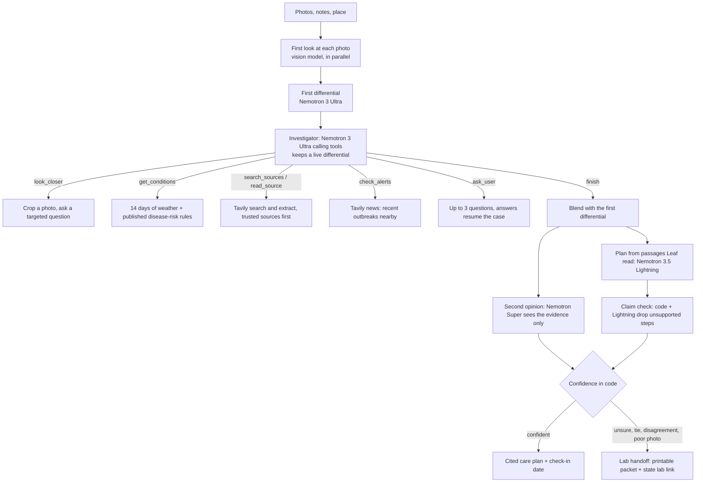

# Leaf

**Snap a sick leaf. Get a cited care plan, or a case ready for a plant clinic.**

Leaf is a plant-doctor agent for home gardeners and small growers. Upload up to three photos of a struggling plant and Leaf ranks the likely causes with a confidence for each, checks your recent weather, reads extension-service sources, gets a second opinion, and writes a short care plan whose every step cites a source it read. When it isn't confident, it says so and hands you a printable case summary for your state's plant diagnostic lab.

Built for the [Nebius x NVIDIA Global AI Hackathon](https://nebiusglobalaihackathon.devpost.com/), Best Apps and Agents track, with Tavily at runtime.

**Try it:** _demo URL coming soon_ · **Video:** _coming soon_

## Why

Gardeners lose plants because early symptoms look alike: a fungal leaf spot, a nutrient problem and sun scorch can all start as brown patches. Search results are generic and forums disagree. A plant clinic works a case differently: it takes a history, looks closely, checks the weather, forms a differential, tests each hypothesis and only then advises, or asks for a sample. Leaf does that workflow in about a minute and shows every step. It does not claim to beat experts; it says when you need one.

## Two modes

**Quick** (about 15 seconds, under 1 cent): one careful look at the photo, a structured diagnosis by Nemotron 3 Ultra, Tavily search, and a care plan by Nemotron 3.5 Lightning. Quick is the default.

**Deep** (about a minute, about 5 cents): an investigator agent works the case with tools, streamed live to the page.



| Step | Model (all calls via Nebius Token Factory) |
| --- | --- |
| First differential, investigator | `nvidia/Nemotron-3-Ultra-550b-a55b`, reasoning on, native tool calling |
| Fallback for every reasoning step, second opinion | `nvidia/nemotron-3-super-120b-a12b` |
| Care plan, claim check, chat, check-in advice, JSON repair | `nvidia/Nemotron-3_5-Lightning` |
| Reading photos | `moonshotai/Kimi-K2.6` with thinking off. Token Factory has no public NVIDIA vision model as of Oct 2026; Leaf picks an image model at startup and prefers an NVIDIA one if it appears |

The investigator's tools, all read-only:

| Tool | What it does |
| --- | --- |
| `look_closer` | Crops a region of an uploaded photo in code and asks the vision model one targeted question |
| `get_conditions` | Last 14 days from Open-Meteo, humid-hour counts, and only the published rules that apply to the crop: TOMCAST for tomato; Hutton, Smith and Wallin for potato. Every threshold is cited in `backend/disease_rules.py` |
| `search_sources` | Tavily search; .edu, .gov and extension services ranked first, open-web results marked untrusted |
| `read_source` | Tavily extract with a relevance query, only on URLs this case's own searches returned (no URL a model writes is ever fetched) |
| `check_alerts` | Tavily news from the last month for outbreak reports in your region |
| `ask_user` | Stops with up to 3 questions that would separate the top two causes |
| `update_differential`, `finish` | Record the ranking, with the evidence ids behind each cause |

**Enforced in code, not left to the model:** 8 counted tool calls, per-tool caps, a dollar budget, a hard 90-second clock with a forced finish, parallel calls counted, Ultra-to-Super fallback per turn, and a fall back to Quick if the investigation fails for any reason. Probabilities are capped at 0.9. The final confidence combines the investigation, the second opinion, photo quality and evidence coverage; low confidence, a near-tie, a poor photo or a disagreeing second opinion always escalates.

## Does Deep help? (measured)

`scripts/eval.py` runs Quick and Deep on the same labelled photos and reports top-1 and top-3 accuracy, the Brier score of the reported confidence (lower is better), escalation precision and recall (an escalation is "right" when the top answer was wrong), cost and time per case. `scripts/calibrate.py` refits Deep's blend and disagreement rule offline from the logged runs.

**Tune split, 22 licensed field photos across ten conditions** (`evals/README.md`). This split was used to tune Leaf, so its numbers are optimistic; the held-out test split of our own phone photos is still being collected. Every run is listed, not just the best one:

| Run | Mode | Top-1 | Top-3 | Brier | Escalated | Escalation precision / recall | Cost / case | Time / case |
| --- | --- | --- | --- | --- | --- | --- | --- | --- |
| first Deep version | Quick | 50% | 82% | 0.287 | 18% | 1.0 / 0.364 | $0.008 | 15 s |
| first Deep version | Deep | 50% | 73% | 0.269 | 73% | 0.5 / 0.727 | $0.051 | 67 s |
| calmer critic, blend 0.4 | Deep | 46% | 59% | 0.202 | 68% | 0.733 / 0.917 | $0.054 | 56 s |
| blend 0.7, before review fixes | Quick | 50% | 68% | 0.270 | 32% | 0.714 / 0.455 | $0.008 | 12 s |
| blend 0.7, before review fixes | Deep | 36% | 64% | 0.205 | 82% | 0.722 / 0.929 | $0.058 | 57 s |
| after review fixes | Deep | 55% | 73% | 0.227 | 91% | 0.45 / 0.9 | $0.056 | 43 s |
| shipped rules | Deep | 41% | 64% | 0.268 | 82% | 0.667 / 0.923 | $0.056 | 51 s |

What this shows, read plainly:

- **Accuracy: no clear winner.** Deep's top-1 ranged from 36% to 55% across 5 runs (mean 45%); Quick scored 50%. On 22 cases one case is 4.5 points, and run-to-run variance (temperature 1.0 models) is about ±10 points.
- **Calibration: Deep is better.** Its mean Brier score is 0.234 against Quick's 0.278. Quick tends to say 70-80% while being right about half the time.
- **Knowing when it is wrong: Deep is much better, at a price.** Deep escalated 88% of its wrong answers on average (Quick: 41%), but it also escalates many correct ones (68%-91% of all cases). Fitting the escalation rules on logged runs (`scripts/calibrate.py`) predicted fewer escalations than the next live run produced: 22 cases are too few to tune on reliably.
- **Cost and time:** Quick about $0.008 and 12-15 s per case; Deep about $0.056 and 45-65 s, well under its 10-cent budget.

So **Quick is the default**, and Deep is offered as the careful mode: slower and more expensive, honest about uncertainty, and grounded in sources it read. The rule we set ourselves is that Deep becomes the default only if it beats Quick on the held-out test split; it has not had that chance yet.

What the investigation does reliably add, whatever the accuracy: a ranked differential tied to evidence the gardener can inspect, local weather and published disease-risk indices, plans that cite only passages Leaf read (with unsupported steps removed), a second opinion, and a lab handoff when the case needs one.

## Plant journal

Every finished report is saved for 30 days under an unguessable link (`/c/<id>`) you can share. Come back with a new photo to check in: Leaf compares it with the last one (spreading, stable or recovering), updates the advice, and escalates anything still spreading. Only small thumbnails are kept, never your full uploads. Storage is SQLite by default behind a small interface, so another backend can plug in.

## Nebius and NVIDIA usage

- **Nebius Token Factory**: every model call (OpenAI-compatible API, `backend/models.py`), including native tool calling for the investigator and live per-token prices from `/models` for the cost meter.
- **NVIDIA Nemotron 3 Ultra, Super and 3.5 Lightning**: every reasoning and writing step.
- **Nebius Serverless Endpoint**: deploys the app container (`scripts/deploy_nebius.sh`).
- **Tavily**: search, extract and news at runtime (`backend/search.py`, `backend/tools.py`).
- **Open-Meteo**: weather for the disease-risk rules. Weather data by [Open-Meteo.com](https://open-meteo.com/) (CC BY 4.0).

## Run it

Requirements: Python 3.11+, a Nebius Token Factory API key, a Tavily API key.

```bash
git clone https://github.com/risshabs22-quantified/leaf.git && cd leaf
make setup          # creates .venv and .env
# add NEBIUS_API_KEY and TAVILY_API_KEY to .env
make smoke-all      # checks keys, models, regions, vision model (under 1 cent + 1 Tavily credit)
make run            # http://localhost:8000
```

Other commands: `make test` (offline tests, no credits), `make check`, `make eval`, `make docker-build`, `make deploy`. See `make help`. Settings are listed in `.env.example`; Deep is capped at 20 cases a day by default (`LEAF_DEEP_DAILY_CAP`).

## Project layout

```text
backend/    FastAPI app; Token Factory client (models.py); Quick pipeline (pipeline.py);
            Deep: agent.py, tools.py, case.py, deep.py, critic.py, claims.py, handoff.py;
            weather and rules (conditions.py, disease_rules.py); journal.py, checkin.py
frontend/   index.html (diagnosis), case.html (shared report), no build step
tests/      offline tests with scripted fake models, tools and search
scripts/    smoke test, eval runner, calibration, Nebius deploy
evals/      labelled photo cases and their licences
docs/       AGENT_V2.md (agent design, verified facts, milestones), PROGRESS.md
.claude/    Claude Code settings, subagents, skills and rules used to build Leaf
```

## Safety

Leaf gives guidance, not certainty. Plans are written only from passages Leaf actually read; a claim check drops any step whose cited source doesn't support it and any rate or dose that isn't in the cited passage, and every chemical step tells you to follow the product label. In code, any low-confidence diagnosis, near-tie, poor photo or disagreeing second opinion escalates to a lab handoff with your state's diagnostic lab and how to send a sample. Weather-based indices are presented as risk signals estimated from modelled humidity, never as proof of disease.

The public demo protects itself and its credits: uploads are size- and pixel-limited and decoded off the event loop, request bodies are capped before they are read, every case runs under a concurrency cap and a deadline, per-IP, daily and Deep-specific limits apply, and the dollar budget per Deep case is enforced. User text, web text and model-written text are sanitised before they enter a prompt and treated as data, not instructions; `read_source` never fetches a URL a model wrote. Photos are not logged; locations are rounded to about 10 km; errors shown to users are generic.

## Feedback on Nebius and NVIDIA

What we learned building on Token Factory with Nemotron (October 2026):

- **Native tool calling on Nemotron 3 Ultra and Super worked first time** through the OpenAI-compatible API, 1-2 s per turn, with parallel tool calls emitted on their own and reasoning returned separately in `reasoning_content`. Streaming tool-call deltas also worked.
- **Do not combine `tools` with `response_format`.** With both, Ultra stopped calling tools and wrote JSON text instead. This is not documented; it took a probe to find.
- **`chat_template_kwargs` is honoured, but the key differs by model family**: Nemotron reads `enable_thinking`, Kimi reads `thinking`. Turning Kimi's thinking off made our vision step 3x faster and 4x cheaper with equally specific observations; documenting the per-model key would save others the search.
- **Reasoning tokens count toward `max_tokens`**, so a reasoning model can return empty or truncated JSON. We retry once with a doubled budget and count the tokens of both attempts toward cost.
- **`/models?verbose=true` includes per-token prices**, which let us meter cost per case live. The public catalog listed Super with `status: "error"` while it answered every request, so we check `/models` at startup instead of trusting the catalog.
- **We missed an NVIDIA vision model, guard model and reranker on Token Factory.** A served NVIDIA VLM would let Leaf run fully on NVIDIA models.

## License

[MIT](LICENSE). Evaluation photos are from Wikimedia Commons under their own licences, listed in `evals/README.md`.
