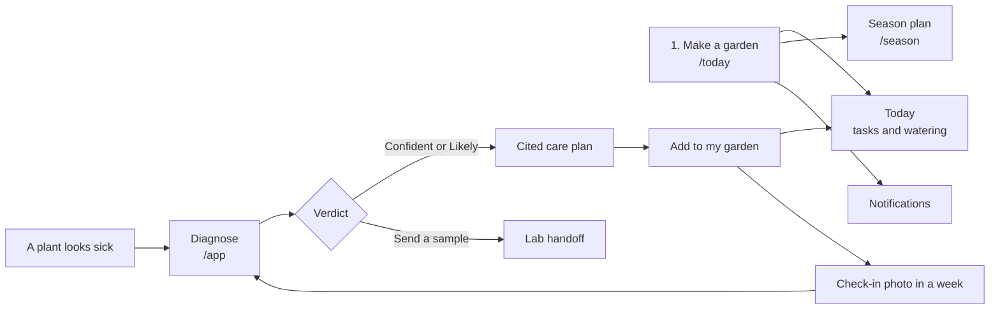
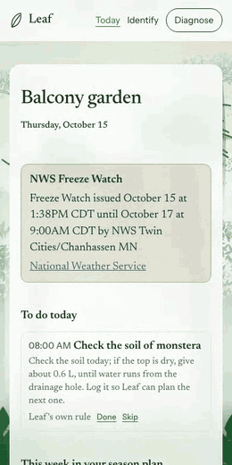

<p align="center">
  
</p>

<p align="center">
  <a href="https://leafathon.site"></a>
  <a href="LICENSE"></a>
  
  
</p>

<p align="center">
  <a href="#use-it">Use it</a> ·
  <a href="#how-a-diagnosis-works">How it decides</a> ·
  <a href="#what-it-gets-right-and-wrong">Accuracy</a> ·
  <a href="#connect-it-to-your-own-tools">API and MCP</a> ·
  <a href="#run-it-yourself">Run it yourself</a> ·
  <a href="#more-docs">Docs</a>
</p>

**Leaf tells you what your garden needs today, plans the next twelve months around your frost dates, and works out what's wrong when a plant gets sick.** Every answer shows its source. When Leaf isn't sure, it says so and points you to a plant clinic instead of guessing.

**[Open Leaf → leafathon.site](https://leafathon.site)** &nbsp;·&nbsp; No account, no install. [How it is running right now](https://leafathon.site/ops).

<table>
  <tr>
    <td width="33%" align="center"><br><sub><b>Today</b>: tasks with a reason and a source</sub></td>
    <td width="33%" align="center"><br><sub><b>Season plan</b>: 52 weeks around your frost dates</sub></td>
    <td width="33%" align="center"><br><sub><b>Diagnose</b>: or "send a sample" when unsure</sub></td>
  </tr>
</table>

Where the answers come from:

| Source | Gives Leaf |
| --- | --- |
| Open-Meteo | Forecast, 30 years of climate, frost dates, soil temperature |
| National Weather Service | Freeze, heat, wind and flood alerts |
| University extension guides, found with Tavily | Care steps, pest timing, disease facts (each cited) |
| Nemotron models on Nebius Token Factory | Reading, ranking, writing and checking (Kimi K2.6 reads the photos) |

Built for the [Nebius x NVIDIA Global AI Hackathon](https://nebiusglobalaihackathon.devpost.com/) (Best Apps and Agents), with Tavily search at runtime.

---

## Use it

Everything is at **[leafathon.site](https://leafathon.site)**, and it works on a phone.



### 1. Make a garden (30 seconds)

1. Open **[/today](https://leafathon.site/today)**.
2. Type a name and your town, or tap **Use my location instead**. Tap **Create my garden**.
3. Fill in each plant, then tap **Add plant**:

| Field | What to enter |
| --- | --- |
| Plant name | tomato, basil, monstera. Not sure? Use **Identify it from a photo** |
| Where | Outdoors or indoors (indoor plants are never watered by the weather) |
| Pot size in litres | Only if it's in a pot. Leave empty for the ground |
| Stage | Seedling, growing, flowering, fruiting, ready to harvest, or not sure |

There is no account. Your garden lives behind a private link, in the **Your private link** box at the bottom of Today. Copy it to open the garden on another device and keep it to yourself: anyone with it can change the garden. **Delete this garden** is on the same page.

### 2. Read Today

| Block | What it shows | What you do |
| --- | --- | --- |
| Alert banner | NWS freeze, heat, wind or flood alerts for your place | Read it. Urgent ones also come as notifications |
| **To do today** | Tasks, urgent first. Each has a reason and a source, or says "Leaf's own rule" | Tap **Done** or **Skip**. Leaf plans the next one from that |
| **Water** | Per plant: water or skip (rain coming, soil still wet) | Water the plants marked *water* |
| **This week in your season plan** | What the plan says for this week | Tap **Open the season plan** |

### 3. Get a season plan

Open **[/season](https://leafathon.site/season)** and tap **Write my plan**. It takes about a minute and a half and runs in the background, so you can leave the page.

| You get | Detail |
| --- | --- |
| 52 weeks | Sowing, planting out, feeding, pruning, frost protection, harvest. Each item has a reason and a source |
| A "Built on" list | Your frost dates, hardiness zone and each plant's frost class, so you can see what the plan assumed |
| Safe dates only | Code removes anything planted too early or too cold, anything that breaks your organic or pet choices, and anything a second model can't support |
| **Add to my calendar (.ics)** and **Print** | At the top of the plan |
| Updates | A frost or a new diagnosis changes only the weeks it affects, and says what changed |

### 4. Diagnose a sick plant

<p align="center"><br><sub>A real session on a phone. The waiting part is sped up.</sub></p>

Open **[/app](https://leafathon.site/app)**, add up to three photos (a close-up of the damage, the whole plant, the underside of a leaf; one is enough), say what you've noticed, and tap **Diagnose**.

| Mode | What it does | Time | Cost |
| --- | --- | --- | --- |
| **Auto** (default) | A quick look first, and a deeper investigation only if it isn't sure | 15 s to about a minute | about 4 cents |
| **Quick** | One careful look at the photo | about 15 s | under 1 cent |
| **Deep** | Works the case like a plant clinic: looks closer, checks your weather, reads sources, gets a second opinion | about a minute | about 5 cents |

Two boxes change the plan: **Organic methods only** and **Pets or children use this garden**. Steps that break either are removed and listed.

You get one of three verdicts, decided by code and never by the model:

| Verdict | What it means | What you get |
| --- | --- | --- |
| **Confident** | One cause is clearly ahead and nothing serious is in play | A cited care plan |
| **Likely** | A favourite, but with a close second or a second opinion that leans elsewhere | The plan, what to watch for, and when to send a sample |
| **Send a sample to a lab** | Causes are spread out, the photo is poor, the second opinion strongly disagrees, or it could be a serious disease | A printable case summary and your state's plant diagnostic lab |

What's on the result page:

| Part | What it shows |
| --- | --- |
| Verdict banner | The verdict and the reason in plain words |
| Ranked causes | Each with a percentage, updating live while Leaf investigates |
| Care plan | Steps that cite the passages Leaf read. The **[1]** links go to the sources |
| Spray window | When the plan uses a product: the best 3 hours in the next five days |
| **Add to my garden** | Pick the plant. The diagnosis becomes tasks and a plan update |
| **Copy a read-only link to share** | The result is saved for 30 days at that link |

Come back to the saved result a week later and add a new photo under **Check-ins**. Leaf compares it with the first and says *spreading*, *stable* or *recovering*, and updates the advice.

### 5. Turn on notifications

On **Today**, under **Notifications**, tap **Turn on notifications**, then **Send a test**. You should get a push within seconds. **Quiet hours** are on the same page; urgent warnings such as a freeze warning still come through, because one held until 7 am is too late.

| Device | Steps |
| --- | --- |
| iPhone or iPad | Open leafathon.site in Safari → **Share** → **Add to Home Screen** → open Leaf from the Home Screen icon → turn notifications on there. Safari tabs can't receive push |
| Android | Open it in Chrome and turn notifications on |
| Computer | Use a browser with Web Push (Chrome, Edge, Firefox), turn notifications on and allow them for the site. Not in a private window |

### 6. The rest of the site

| Page | What it's for |
| --- | --- |
| **[Radar](https://leafathon.site/radar)** | Pick a state: what its university extension service says is being seen now, each report a sentence from the page with its date and link. "No current report" is normal; Radar shows nothing rather than guess |
| **[Identify](https://leafathon.site/identify)** | Name a plant from a photo, with what Leaf checked it against |
| **[My plants](https://leafathon.site/plants)** | Every diagnosis you saved, its verdict, and the date to check again |
| **[Connect](https://leafathon.site/connect)** | API keys, the MCP server, Home Assistant ([below](#connect-it-to-your-own-tools)) |
| **[/ops](https://leafathon.site/ops)** | Live counts of what the platform is doing and spending. No personal data |

---

## How a diagnosis works

<p align="center"></p>

| Models do | Code does |
| --- | --- |
| Read the photo, rank the likely causes, write the plan | Decide the verdict (Confident, Likely, or lab) |
| Give a second opinion, verify season plans | Remove anything unsafe, unsupported or against your organic and pet choices |
| Screen web pages for hidden instructions | Compute frost dates, the water balance, spray windows and every limit |

| Step | Model |
| --- | --- |
| Reads the photos | **Kimi K2.6**, with **Nemotron 3.5 Super VL** as the automatic fallback |
| Ranks causes, investigates, writes season plans | **Nemotron 3 Ultra** |
| Second opinion, verifies plans (can only remove items) | **Nemotron 3 Super** |
| Care plan, claim check, front door, notification wording | **Nemotron 3.5 Lightning** |
| Screens web pages and notes for hidden instructions | **Nemotron Nano 3** |

We wanted an all-NVIDIA pipeline, so we measured NVIDIA's vision model against Kimi on the same photos. Kimi was about 16 points better, so it reads the photos. The numbers are [below](#what-it-gets-right-and-wrong) and written up for NVIDIA in [`docs/FEEDBACK.md`](docs/FEEDBACK.md). The engineering is in [`docs/HOW_IT_WORKS.md`](docs/HOW_IT_WORKS.md).

---

## What it gets right and wrong

Measured on real runs in October 2026. Every table, method and run is in [`docs/NUMBERS.md`](docs/NUMBERS.md).

| Test | Result |
| --- | --- |
| **24 photos Leaf was never tuned on**, Kimi reading, Quick mode | Right first time **50%**, in the top three **67%**. Hard photos (fruit, insects, odd problems), not tidy leaf shots |
| When it said **Confident** on those photos | Right **6 of 9** times. Set at the strictest level that was right on every tuning photo, and it still over-claimed on new ones |
| Same photos, NVIDIA vision model | 33% and 46%. Never says Confident (it couldn't be made reliable) |
| The 52 photos it was tuned on, Auto | 58% first time (optimistic: it was tuned on them) |
| Identify a plant, 40 photos | 92.5% right alone, 95% after checking against sources |
| Hardiness zone, five US cities | Within half a zone of the USDA map in all five |

| Work | Cost | Time |
| --- | --- | --- |
| Quick diagnosis | under 1 cent | about 15 s |
| Auto diagnosis | about 4 cents | about 30 s |
| Full season plan | 21 cents | 70 to 110 s |
| Replan of the affected weeks | about 1 cent | 12 s |
| Identify a plant | about 0.3 cents | a few seconds |
| Estimated, per active user per day | about half a cent | |

A hard daily spend cap protects the account, and the site falls back to rules-only care at the cap.

---

## Connect it to your own tools

Open **[/connect](https://leafathon.site/connect)** from your garden's Today page and make a key. It is shown once and stored only as a hash.

| Scope | Allows |
| --- | --- |
| `read` | The garden, Today, the season plan and readings |
| `readings` | Sending soil moisture (Home Assistant) |
| `tools` | Diagnose, identify, weather risk, start a season plan (these use Leaf's models) |

**Claude Code and other MCP clients** have five tools: `diagnose`, `identify`, `care_plan`, `season_plan`, `weather_risk`.

<p align="center"></p>

```bash
claude mcp add --transport http leaf https://leafathon.site/mcp \
  --header "Authorization: Bearer lf_..."
```

**REST API.** Send `Authorization: Bearer lf_...`. The OpenAPI document is at [`/api/v1/openapi.json`](https://leafathon.site/api/v1/openapi.json).

| Call | What it does |
| --- | --- |
| `GET /api/v1/garden` | The key's garden |
| `GET /api/v1/today` | The garden's day |
| `GET /api/v1/season` · `POST /api/v1/season` | Read, or write, the season plan |
| `POST /api/v1/readings` · `GET /api/v1/readings` | Send, or list, soil moisture readings |
| `POST /api/v1/diagnose` | Diagnose a plant problem (multipart: `image`, `notes`) |
| `POST /api/v1/identify` | Identify a plant from a photo |
| `GET /api/v1/weather-risk` | Frost, heat and wind risk |

```bash
curl https://leafathon.site/api/v1/diagnose -H "Authorization: Bearer lf_..." \
  -F image=@leaf.jpg -F notes="brown spots with yellow rings"
```

<details>
<summary><b>Home Assistant soil sensor</b></summary>

A reading under 12 hours old replaces Leaf's weather-based watering estimate for that plant. Below the dry mark (30% unless you send `dry_below`) Leaf asks you to water. Make a key with the `readings` scope, then:

```yaml
# configuration.yaml
rest_command:
  leaf_soil_moisture:
    url: "https://leafathon.site/api/v1/readings"
    method: POST
    headers:
      Authorization: "Bearer lf_..."
      Content-Type: "application/json"
    payload: '{"plant_id": "{{ plant_id }}", "value": {{ value }}, "source": "{{ source }}"}'
```

Call it from an automation whenever your sensor changes. **Try it without a sensor**, on the Connect page, sends a reading labelled TEST.
</details>

---

## Run it yourself

You need Python 3.11+, a [Nebius Token Factory](https://tokenfactory.nebius.com/) key and a [Tavily](https://tavily.com/) key.

```bash
git clone https://github.com/risshabs22-quantified/leaf.git && cd leaf
make setup        # creates .venv and the env file from the example
# put NEBIUS_API_KEY and TAVILY_API_KEY in that env file
make smoke-all    # checks keys, models and the vision model (under 1 cent + 1 Tavily credit)
make run          # http://localhost:8000
```

| Command | Does |
| --- | --- |
| `make test` | 835 offline tests with fake models and search; they never spend credits |
| `make check` | Tests, lint and the Worker type check. Run before every push |
| `make eval` | Scores diagnosis accuracy on the labelled photos (spends model and search credits) |
| `make deploy-cloudflare` | Deploys to Cloudflare Containers |
| `make help` | Lists the rest. Settings are in `.env.example` |

<details>
<summary><b>Where things are</b></summary>

```text
backend/    FastAPI app, Token Factory client, routing table (config.py)
  climate/    forecast, climatology, frost dates, NWS alerts, water balance
  knowledge/  cited species facts, plant identification
  care/       the daily planner       season/   the season plan
  radar/      state-by-state reports  connect/  API keys, REST API, MCP
  pipeline.py, deep.py, agent.py, verdict.py   the doctor
frontend/   static pages, no build step
cloudflare/ the Worker: cron, queue, data bridge
tests/      offline tests      scripts/   smoke test, evals, deploy
evals/      labelled photos and their licences
docs/       architecture, numbers, feedback for Nebius and NVIDIA, progress log
```
</details>

---

## Honest limits

| Area | What to know |
| --- | --- |
| Advice | Guidance, not certainty. For food crops and any chemical, follow the product label. Every chemical step says so |
| Accuracy | About half right first time on hard photos. When unsure, Leaf says so and points to a lab |
| Photos | Not logged. Only small thumbnails are kept, for 30 days, behind a link nobody can guess |
| Location | Rounded to about 1 km. A garden can be deleted from its page, and gardens nobody opens for four months are deleted |
| Radar | US states only, and it often finds little, because extension sites mostly publish evergreen guides |
| Not yet verified | A push notification on a real phone, and the Home Assistant snippet on a real Home Assistant. The web app, season plan, diagnosis, REST API and the MCP server from Claude Code are verified |

## More docs

| | |
| --- | --- |
| [`docs/HOW_IT_WORKS.md`](docs/HOW_IT_WORKS.md) | Architecture, each model's job, the guardrails, platform engineering |
| [`docs/NUMBERS.md`](docs/NUMBERS.md) | Every measurement, with method and limits |
| [`docs/FEEDBACK.md`](docs/FEEDBACK.md) | What we hit on Token Factory and Nemotron, with repro steps |
| [`evals/README.md`](evals/README.md) | The photo sets, licences and the rules that keep the test split clean |
| [`docs/LEAF_PLATFORM.md`](docs/LEAF_PLATFORM.md) | The platform plan, limits and decisions |

## License

Leaf's code is [MIT](LICENSE). The evaluation photos in `evals/images/` are **not** MIT: each keeps its own Wikimedia Commons licence (CC0, public domain, CC BY or CC BY-SA), listed with author and source in `evals/README.md`. Weather data by [Open-Meteo.com](https://open-meteo.com/) (CC BY 4.0).
