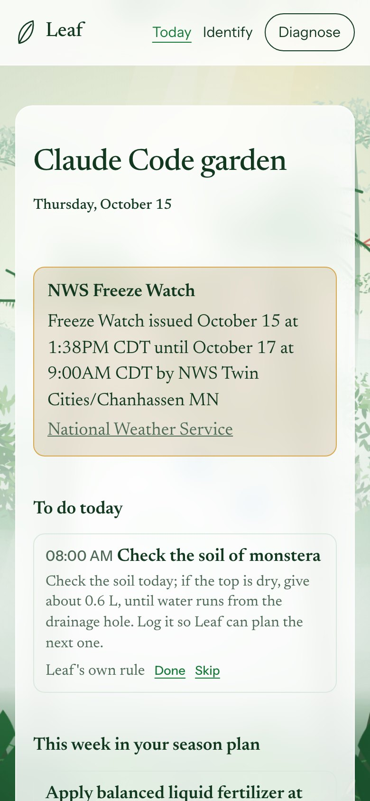
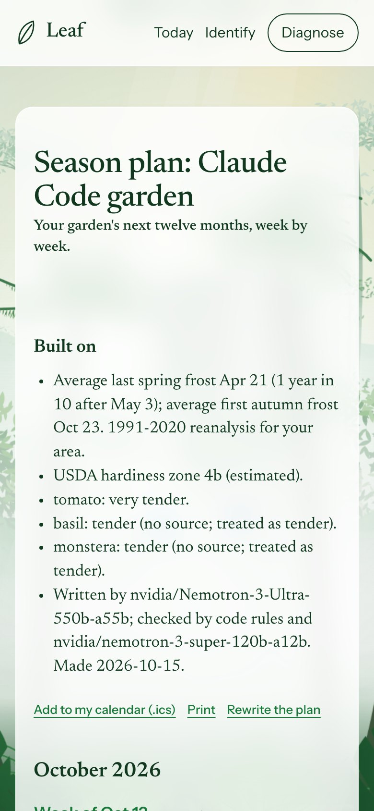
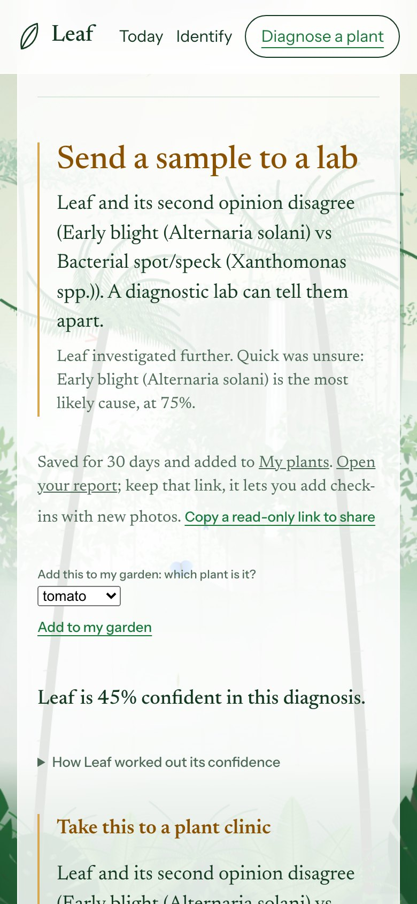

<p align="center">
  
</p>

<p align="center">
  <a href="https://leafathon.site"></a>
  <a href="LICENSE"></a>
  
  
</p>

<p align="center">
  <a href="#use-it">Use it</a> ·
  <a href="#how-a-diagnosis-works">How it decides</a> ·
  <a href="#what-it-gets-right-and-wrong">Accuracy</a> ·
  <a href="#connect-it-to-your-own-tools">API and MCP</a> ·
  <a href="#run-it-yourself">Run it yourself</a> ·
  <a href="#more-docs">Docs</a>
</p>

**Leaf tells you what your garden needs today, plans the next twelve months around your frost dates, and works out what's wrong when a plant gets sick.** It uses your own forecast, National Weather Service alerts and university extension guides, and it shows the source for what it says. When it isn't sure, it says so and points you to a plant clinic instead of guessing.

**[Open Leaf → leafathon.site](https://leafathon.site)** &nbsp;·&nbsp; No account, no install. [How it is running right now](https://leafathon.site/ops).

<table>
  <tr>
    <td width="33%" align="center"><br><sub><b>Today</b>: tasks with a reason and a source</sub></td>
    <td width="33%" align="center"><br><sub><b>Season plan</b>: 52 weeks around your frost dates</sub></td>
    <td width="33%" align="center"><br><sub><b>Diagnose</b>: or "send a sample" when unsure</sub></td>
  </tr>
</table>

Built for the [Nebius x NVIDIA Global AI Hackathon](https://nebiusglobalaihackathon.devpost.com/) (Best Apps and Agents), with Tavily search at runtime. Every model call goes to Nebius Token Factory.

---

## Use it

Everything lives at **[leafathon.site](https://leafathon.site)**. Works on a phone; on iPhone, install it to the Home Screen to get notifications.

### 1. Make a garden (30 seconds)

1. Open **[/today](https://leafathon.site/today)**.
2. Type a name and your town, or tap **Use my location instead**. Tap **Create my garden**.
3. Add each plant: its name (tomato, basil, monstera), outdoors or indoors, the pot size in litres if it's in a pot, and its stage. Tap **Add plant**. Not sure what a plant is? **Identify it from a photo** is right there.

There is no account. Your garden lives behind a private link (the **Your private link** box at the bottom of Today). Copy it to open the same garden on another device, and keep it to yourself: anyone with the link can change the garden. You can delete a garden from the same page.

### 2. Read Today

Each morning Leaf works out what each plant needs, from your forecast and alerts.

- **To do today**: urgent things first (frost tonight, a heat wave, wind, a flood alert), then watering and checks. Every task says why and where the rule comes from, or says "Leaf's own rule". Tap **Done** or **Skip**; Leaf uses that to plan the next one.
- **Water**: per plant, *water* or *skip* (rain is coming, soil still wet). Indoor plants use a separate model, since the weather doesn't water them.
- **This week in your season plan**: what the plan says for this week.

### 3. Get a season plan

Open **[/season](https://leafathon.site/season)** and tap **Write my plan**. It takes about a minute and a half and runs in the background, so you can leave the page. You get 52 weeks of sowing, planting out, feeding, pruning, frost protection and harvest, each with a reason and a source. Code checks every item against your frost dates and temperatures; anything unsafe is removed and listed. **Add to my calendar (.ics)** and **Print** are at the top. A frost or a new diagnosis updates only the weeks it affects, and says what changed.

### 4. Diagnose a sick plant

Open **[/app](https://leafathon.site/app)**.

1. Add up to three photos: a close-up of the damage, the whole plant, the underside of a leaf. One is enough.
2. Say what you've noticed ("brown spots with yellow rings on the lower leaves, after a week of rain").
3. Pick how hard Leaf should look. **Auto** (the default) takes a quick look and investigates further only if it isn't sure. **Quick** is one look, about 15 seconds. **Deep** works the case like a clinic, about a minute.
4. Tick **Organic methods only** or **Pets or children use this garden** if they apply. Plans then exclude anything that breaks those rules.
5. Tap **Diagnose**.

You get one of three verdicts, decided by code and never by the model:

| Verdict | What it means | What you get |
| --- | --- | --- |
| **Confident** | One cause is clearly ahead and nothing serious is in play | A cited care plan |
| **Likely** | A favourite, but with a close second or a second opinion that leans elsewhere | The plan, what to watch for, and when to send a sample |
| **Send a sample to a lab** | Causes are spread out, the photo is poor, the second opinion strongly disagrees, or it could be a serious disease (late blight, citrus greening, boxwood blight and a few more) | A printable case summary and your state's plant diagnostic lab |

Under the verdict: the ranked causes with a percentage each, a care plan whose steps cite the passages Leaf actually read (the **[1]** links go to the sources), and, when the plan uses a product, the best time to spray over the next five days. Tap **Add to my garden** to turn the diagnosis into tasks and a plan update. Each result is saved for 30 days at a link you can share. Open it a week later and add a new photo under **Check-in**: Leaf compares it with the first one and tells you whether it's spreading, stable or recovering.

### 5. Turn on notifications

On **Today**, under **Notifications**, tap **Turn on notifications**, then **Send a test**. You should get a push within seconds. Set **Quiet hours** there too. Urgent warnings, like a freeze warning, still come through during quiet hours, because one held until 7 am is too late.

On iPhone and iPad: tap **Share → Add to Home Screen**, then open Leaf from the Home Screen icon and turn notifications on there. Safari tabs can't receive push.

### 6. The rest

- **[Radar](https://leafathon.site/radar)**: pick a state to see what its university extension service says is being seen right now. Each report is a sentence copied from the page, with its date and a link. "No current report" is normal; Radar shows nothing rather than guess.
- **[Identify](https://leafathon.site/identify)**: a photo of any plant, and Leaf names it and shows what it checked.
- **[My plants](https://leafathon.site/plants)**: every diagnosis you saved, with its verdict and the date to check again.
- **[/ops](https://leafathon.site/ops)**: live counts of what the platform is doing and spending. No personal data.

---

## How a diagnosis works

<p align="center"></p>

Models look, reason and write. **Code decides**: the verdict, every safety rule, frost dates, the water balance, spray windows, every limit. A care-plan step that its own source doesn't support is dropped before you see it.

| Step | Model |
| --- | --- |
| Reads the photos | **Kimi K2.6**, with **Nemotron 3.5 Super VL** as the automatic fallback |
| Ranks causes, investigates, writes season plans | **Nemotron 3 Ultra** |
| Second opinion, verifies plans (can only remove items) | **Nemotron 3 Super** |
| Care plan, claim check, front door, notification wording | **Nemotron 3.5 Lightning** |
| Screens web pages and notes for hidden instructions | **Nemotron Nano 3** |

Why Kimi reads the photos: we wanted an all-NVIDIA pipeline, measured NVIDIA's vision model against Kimi on the same photos, and Kimi was about 16 points better. [The numbers are below](#what-it-gets-right-and-wrong) and written up for NVIDIA in [`docs/FEEDBACK.md`](docs/FEEDBACK.md).

Everything else, in order: the weather comes from Open-Meteo and the National Weather Service, sources from Tavily search, and the whole thing runs on one Cloudflare container behind a Worker. The details are in [`docs/HOW_IT_WORKS.md`](docs/HOW_IT_WORKS.md).

---

## What it gets right and wrong

Measured on real runs in October 2026. The full tables, methods and every run are in [`docs/NUMBERS.md`](docs/NUMBERS.md).

| | Result |
| --- | --- |
| **Diagnosis, 24 photos Leaf was never tuned on** | Kimi reading the photos, Quick mode: right first time **50%**, right answer in the top three **67%**. Hard photos (fruit, insects, odd problems), not tidy leaf shots |
| When it said **Confident** on those photos | Right **6 of 9** times. Set at the strictest level that was right on every one of the 52 photos it was tuned on, and it still over-claimed on new ones. Leaf shows this rather than hiding it |
| The NVIDIA vision model, same photos | 33% and 46%. Never says Confident (it couldn't be made reliable) |
| 52 photos it was tuned on | Auto: 58% first time (optimistic, because it was tuned on them) |
| Identify a plant, 40 photos | 92.5% right alone, 95% after checking against sources |
| Hardiness zone, five US cities | Within half a zone of the USDA map in all five |

What it costs: a Quick diagnosis is under a cent, an Auto one about 4 cents, a full season plan 21 cents. A hard daily spend cap protects the account. Estimated cost per active user: about half a cent a day.

---

## Connect it to your own tools

Open **[/connect](https://leafathon.site/connect)** from your garden's Today page and make a key (shown once, stored only as a hash). Choose its scopes: `read`, `readings`, `tools`.

**Claude Code and other MCP clients** (tools: `diagnose`, `identify`, `care_plan`, `season_plan`, `weather_risk`):

```bash
claude mcp add --transport http leaf https://leafathon.site/mcp \
  --header "Authorization: Bearer lf_..."
```

Then ask: *"Using Leaf, what should I do in my garden today?"*

**REST API** (OpenAPI at [`/api/v1/openapi.json`](https://leafathon.site/api/v1/openapi.json)):

```bash
curl https://leafathon.site/api/v1/today -H "Authorization: Bearer lf_..."
curl https://leafathon.site/api/v1/diagnose -H "Authorization: Bearer lf_..." \
  -F image=@leaf.jpg -F notes="brown spots with yellow rings"
```

<details>
<summary><b>Home Assistant soil sensor</b></summary>

A reading under 12 hours old replaces Leaf's weather-based watering estimate for that plant. Below the dry mark (30% unless you send `dry_below`) Leaf asks you to water. Make a key with the `readings` scope, then:

```yaml
# configuration.yaml
rest_command:
  leaf_soil_moisture:
    url: "https://leafathon.site/api/v1/readings"
    method: POST
    headers:
      Authorization: "Bearer lf_..."
      Content-Type: "application/json"
    payload: '{"plant_id": "{{ plant_id }}", "value": {{ value }}, "source": "{{ source }}"}'
```

Call it from an automation whenever your sensor changes. **Try it without a sensor**, on the Connect page, sends a reading labelled TEST.
</details>

---

## Run it yourself

You need Python 3.11+, a [Nebius Token Factory](https://tokenfactory.nebius.com/) key and a [Tavily](https://tavily.com/) key.

```bash
git clone https://github.com/risshabs22-quantified/leaf.git && cd leaf
make setup        # creates .venv and the env file from the example
# put NEBIUS_API_KEY and TAVILY_API_KEY in that env file
make smoke-all    # checks keys, models and the vision model (under 1 cent + 1 Tavily credit)
make run          # http://localhost:8000
```

`make test` runs the offline tests (835, with fake models and search; they never spend credits). `make check` adds lint and the Worker type check. `make help` lists the rest. Settings are in `.env.example`. Hosting on Cloudflare Containers is `make deploy-cloudflare`.

<details>
<summary><b>Where things are</b></summary>

```text
backend/    FastAPI app, Token Factory client, routing table (config.py)
  climate/    forecast, climatology, frost dates, NWS alerts, water balance
  knowledge/  cited species facts, plant identification
  care/       the daily planner       season/   the season plan
  radar/      state-by-state reports  connect/  API keys, REST API, MCP
  pipeline.py, deep.py, agent.py, verdict.py   the doctor
frontend/   static pages, no build step
cloudflare/ the Worker: cron, queue, data bridge
tests/      offline tests      scripts/   smoke test, evals, deploy
evals/      labelled photos and their licences
docs/       architecture, numbers, feedback for Nebius and NVIDIA, progress log
```
</details>

---

## Honest limits

- Leaf gives guidance, not certainty. For food crops and any chemical, follow the product label. Every chemical step says so.
- Photos are not logged. Only small thumbnails are kept, for 30 days, under a link nobody can guess. A garden's location is rounded (about 1 km) and a garden can be deleted from its page.
- Radar covers US states and often finds little, because extension sites mostly publish evergreen guides.
- Verified in real use: the web app, the season plan, the diagnosis, the REST API and the MCP server from Claude Code. Not yet verified: a push notification on a real phone, and the Home Assistant snippet on a real Home Assistant.

## More docs

| | |
| --- | --- |
| [`docs/HOW_IT_WORKS.md`](docs/HOW_IT_WORKS.md) | Architecture, each model's job, the guardrails, platform engineering |
| [`docs/NUMBERS.md`](docs/NUMBERS.md) | Every measurement, with method and limits |
| [`docs/FEEDBACK.md`](docs/FEEDBACK.md) | What we hit on Token Factory and Nemotron, with repro steps |
| [`evals/README.md`](evals/README.md) | The photo sets, licences and the rules that keep the test split clean |
| [`docs/LEAF_PLATFORM.md`](docs/LEAF_PLATFORM.md) | The platform plan, limits and decisions |

## License

Leaf's code is [MIT](LICENSE). The evaluation photos in `evals/images/` are **not** MIT: each keeps its own Wikimedia Commons licence (CC0, public domain, CC BY or CC BY-SA), listed with author and source in `evals/README.md`. Weather data by [Open-Meteo.com](https://open-meteo.com/) (CC BY 4.0).
