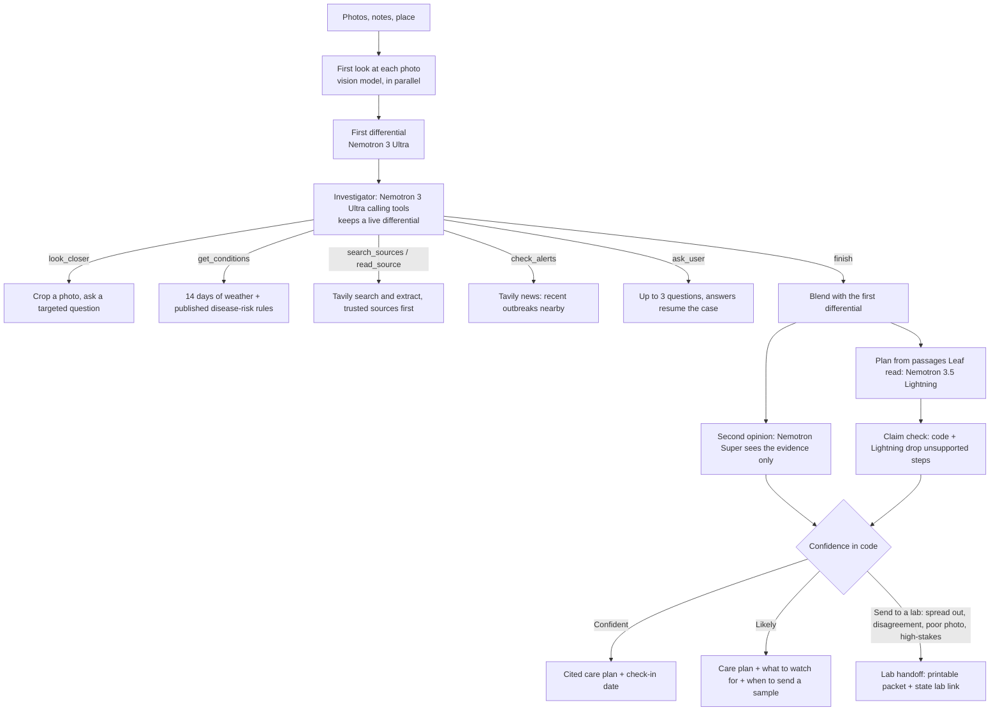

# Leaf

**Snap a sick leaf. Get a cited care plan, or a case ready for a plant clinic.**

Leaf is a plant-doctor agent for home gardeners and small growers. Upload up to three photos of a struggling plant and Leaf ranks the likely causes with a confidence for each, checks your recent weather, reads extension-service sources, gets a second opinion, and writes a short care plan whose every step cites a source it read. When it isn't confident, it says so and hands you a printable case summary for your state's plant diagnostic lab.

Built for the [Nebius x NVIDIA Global AI Hackathon](https://nebiusglobalaihackathon.devpost.com/), Best Apps and Agents track, with Tavily at runtime.

**Try it:** https://leafathon.site · **Video:** _coming soon_

## Why

Gardeners lose plants because early symptoms look alike: a fungal leaf spot, a nutrient problem and sun scorch can all start as brown patches. Search results are generic and forums disagree. A plant clinic works a case differently: it takes a history, looks closely, checks the weather, forms a differential, tests each hypothesis and only then advises, or asks for a sample. Leaf does that workflow in about a minute and shows every step. It does not claim to beat experts; it says when you need one.

## Three modes, three verdicts

**Auto** (the default; 15 seconds to about a minute, about 4 cents on average): runs Quick first, and only when Quick is not confident does it open a Deep investigation, seeded with Quick's look at the photo, its differential, evidence and sources so nothing is repeated. The page shows when and why Leaf decided to look further ("Quick was unsure: early blight is most likely, but Septoria leaf spot is close behind").

**Quick** (about 15 seconds, under 1 cent): one careful look at the photo, a structured diagnosis by Nemotron 3 Ultra, Tavily search, and a care plan by Nemotron 3.5 Lightning.

**Deep** (about 40 seconds, about 5 cents): an investigator agent works the case with tools, streamed live to the page.

Every answer ends in one of three verdicts, decided in code (`backend/verdict.py`), never by the model:

| Verdict | When | What you get |
| --- | --- | --- |
| **Confident** | the leading cause is well ahead, the photo is usable, nothing high-stakes is in play | a cited care plan |
| **Likely** | a clear favourite, but a weaker lead, a close second, or a second opinion that leans elsewhere | the care plan, what to watch for that would change the diagnosis, and when to send a sample |
| **Send to a lab** | the causes are spread out, the photo is too poor, the second opinion strongly disagrees, or a high-stakes condition is in the top two or at 20% or more anywhere | a printable case summary and your state's plant diagnostic lab |

High-stakes conditions are the ones where a wrong guess hurts more than the gardener's plant: late blight (spores travel miles; extension services ask growers to report it), tomato brown rugose fruit virus, sudden oak death, citrus greening, Ralstonia race 3 biovar 2, boxwood blight, spotted lanternfly and box tree moth, each with its APHIS or extension source in `backend/diseases.py`.



| Step | Model (all calls via Nebius Token Factory) |
| --- | --- |
| First differential, investigator | `nvidia/Nemotron-3-Ultra-550b-a55b`, reasoning on, native tool calling |
| Fallback for every reasoning step, second opinion | `nvidia/nemotron-3-super-120b-a12b` |
| Care plan, claim check, chat, check-in advice, JSON repair | `nvidia/Nemotron-3_5-Lightning` |
| Reading photos | `moonshotai/Kimi-K2.6` with thinking off. Token Factory has no public NVIDIA vision model as of Oct 2026; Leaf picks an image model at startup and prefers an NVIDIA one if it appears |

The investigator's tools, all read-only:

| Tool | What it does |
| --- | --- |
| `look_closer` | Crops a region of an uploaded photo in code and asks the vision model one targeted question |
| `get_conditions` | Last 14 days from Open-Meteo, humid-hour counts, and only the published rules that apply to the crop: TOMCAST for tomato; Hutton, Smith and Wallin for potato. Every threshold is cited in `backend/disease_rules.py` |
| `search_sources` | Tavily search; .edu, .gov and extension services ranked first, open-web results marked untrusted |
| `read_source` | Tavily extract with a relevance query, only on URLs this case's own searches returned (no URL a model writes is ever fetched) |
| `check_alerts` | Tavily news from the last month for outbreak reports in your region |
| `ask_user` | Stops with up to 3 questions that would separate the top two causes |
| `update_differential`, `finish` | Record the ranking, with the evidence ids behind each cause |

**Enforced in code, not left to the model:** 8 counted tool calls, per-tool caps, a dollar budget, a hard 90-second clock with a forced finish, parallel calls counted, Ultra-to-Super fallback per turn, and a fall back to Quick if the investigation fails for any reason. Probabilities are capped at 0.9. The final confidence combines the investigation, the second opinion, photo quality and evidence coverage, and the verdict comes from it in code. If the investigator never searched, Leaf searches for the leading diagnosis itself before writing the plan, so every plan step can cite a passage it read.

## Quick, Deep and Auto (measured)

`scripts/eval.py` runs each mode on the same labelled photos and reports top-1 and top-3 accuracy, how often each verdict was right, the lab-referral rate, the Brier score of the reported confidence (lower is better), cost and time per case. Names are scored through `backend/diseases.py`, so "Alternaria solani" counts as early blight and "bacterial speck" does not count as bacterial spot. `scripts/fit_verdicts.py` fits the verdict thresholds and `scripts/calibrate.py` Deep's blend, both offline from logged runs.

**Tune split: 52 licensed photos, 31 diseases, 15 abiotic problems, 6 pests** (`evals/README.md`). These photos were used to tune Leaf, including the verdict thresholds, so the numbers are optimistic; the held-out test split of our own phone photos is still being collected and nothing has been tuned on it. One run per mode, 13 October 2026:

| Mode | Top-1 | Top-3 | When it said Confident | Likely right | Sent to a lab | Brier | Cost / case | Time / case |
| --- | --- | --- | --- | --- | --- | --- | --- | --- |
| Quick | 52% | 75% | right 11 of 12 | 15 of 37 (top-3: 25) | 3 (6%) | 0.264 | $0.009 | 16 s |
| Deep | 56% | 73% | right 7 of 8 | 14 of 24 (top-3: 18) | 20 (38%) | 0.210 | $0.054 | 40 s |
| **Auto** | **58%** | 73% | **right 14 of 16** | 10 of 23 | 13 (25%) | **0.204** | $0.037 | 31 s |

Auto's row is live; Quick's and Deep's verdict columns replay their logged runs through the final thresholds, which were fitted on those same runs, so they flatter Quick and Deep slightly (the raw `evals/summary_tune_sprint-*.json` files show the verdicts under the first, unfitted thresholds). Auto investigated 69% of cases.

What this shows, read plainly:

- **Auto is the default because it beat Quick on this split**: 3 more cases right at top-1 (58% vs 52%), better calibrated (Brier 0.204 vs 0.264), about 4 times the cost. On 52 cases one case is about 2 points and repeat runs of the same mode vary by several points, so this is a modest lead, not a proven one.
- **"Confident" means something.** When Leaf said Confident it was right 14 of 16 times in Auto (and 11 of 12 in Quick's replay). It says Confident on about a third of cases.
- **"Likely" is where the misses are.** More than half of Quick's and Auto's Likely answers were wrong at top-1 (Deep: 10 of 24), though the right answer is usually in the top three; that is why Likely comes with what to watch for and when to send a sample.
- **Lab referrals:** 9 of Auto's 13 were warranted (the top answer was wrong, or the condition was late blight). Three of the four late blight photos went to a lab. The fourth is Leaf's worst answer on this split: Auto said **Confident: powdery mildew** (85%) on a late blight leaf, because the vision model reported a white powdery coating that is not there. Late blight is the condition Leaf misses most, for that reason.
- **Where Leaf is wrong**, from looking at all 25 Quick misses (`docs/ACCURACY_AUDIT.md`): 12 reasoning errors (10 with the right answer in the top three, the kind Deep fixes), 6 where the vision model missed or invented a feature, 7 photos that are genuinely ambiguous, 0 naming mismatches.
- **A structured symptom checklist in the vision step did not help** (top-1 48% with it, 52% without; it fixed 5 cases and broke 7), so it is off by default.

Earlier runs on the first 22 photos, kept for the record (escalation then meant a yes/no flag, before the three verdicts):

| Run | Mode | Top-1 | Top-3 | Brier | Escalated | Escalation precision / recall | Cost / case | Time / case |
| --- | --- | --- | --- | --- | --- | --- | --- | --- |
| first Deep version | Quick | 50% | 82% | 0.287 | 18% | 1.0 / 0.364 | $0.008 | 15 s |
| first Deep version | Deep | 50% | 73% | 0.269 | 73% | 0.5 / 0.727 | $0.051 | 67 s |
| calmer critic, blend 0.4 | Deep | 46% | 59% | 0.202 | 68% | 0.733 / 0.917 | $0.054 | 56 s |
| blend 0.7, before review fixes | Quick | 50% | 68% | 0.270 | 32% | 0.714 / 0.455 | $0.008 | 12 s |
| blend 0.7, before review fixes | Deep | 36% | 64% | 0.205 | 82% | 0.722 / 0.929 | $0.058 | 57 s |
| after review fixes | Deep | 55% | 73% | 0.227 | 91% | 0.45 / 0.9 | $0.056 | 43 s |
| shipped rules | Deep | 41% | 64% | 0.268 | 82% | 0.667 / 0.923 | $0.056 | 51 s |

What the investigation adds whatever the accuracy: a ranked differential tied to evidence the gardener can inspect, local weather and published disease-risk indices, plans that cite only passages Leaf read (with unsupported steps removed), a second opinion, and a lab handoff when the case needs one.

## Plant journal

Every finished report is saved for 30 days under an unguessable link (`/c/<id>`) you can share. Come back with a new photo to check in: Leaf compares it with the last one (spreading, stable or recovering), updates the advice, and escalates anything still spreading. Only small thumbnails are kept, never your full uploads. Storage sits behind a small interface: SQLite locally, or an S3-compatible Object Storage bucket in production (`LEAF_JOURNAL_BUCKET`). `scripts/pin_case.py <id> --until 2027-01-31` keeps a demo link alive past the 30 days.

## After the diagnosis

Three tools for actually saving the plant. Each one is decided in code, not by a model.

- **Organic and pet-safe plans.** Tick "Organic methods only" or "Pets or children use this garden". The plan writer is told, and then every step is checked in code against a table of 33 active ingredients (`backend/actives.py`): organic or not (USDA National Organic Program allowed actives), risk to pets, harm to bees. Steps that break your choice are removed and listed with the reason. Plan-wide warnings cover oil with sulfur (leaf burn), bee-harming products (spray at dusk) and what to do if a pet eats a treated plant. The same rules apply to check-in advice.
- **The best time to spray** (`backend/spray.py`, `POST /api/spray-window`). When a plan applies a product, Leaf scores every daylight hour of the next five days of Open-Meteo forecast: leaves dry, at least 6 dry hours after (24 is best), wind at most 16 km/h (10 mph) with gusts at most 24 km/h, between 7 C and a heat limit that drops from 32 C to 29 C (85 F) when the plan uses oil or sulfur, and only early morning or evening for bee-harming products. It suggests the best 3-hour window, preferring a sooner day when it is nearly as good, and shows the whole five-day grid.
- **My plants and reminders** (`/plants`). Every report you save is listed on your device with its verdict, last check-in status and the date to check again. Add a check-in or a spray window to Google Calendar (an add-event link) or to Apple Calendar and Outlook (an `.ics` file from `POST /api/calendar.ics`, whose links can only point at Leaf pages). A private link moves the list to another device; there is no account.

Pages: `/` explains Leaf, `/app` diagnoses a plant, `/plants` lists your plants, `/c/<id>` is a saved report.

## Nebius and NVIDIA usage

- **Nebius Token Factory**: every model call (OpenAI-compatible API, `backend/models.py`), including native tool calling for the investigator and live per-token prices from `/models` for the cost meter.
- **NVIDIA Nemotron 3 Ultra, Super and 3.5 Lightning**: every reasoning and writing step.
- **Hosting**: Leaf runs on Cloudflare Containers (`cloudflare/`, `make deploy-cloudflare`), with saved reports in a Cloudflare R2 bucket. Cloudflare only hosts the app: every model call goes to Nebius Token Factory.
- **Tavily**: search, extract and news at runtime (`backend/search.py`, `backend/tools.py`).
- **Open-Meteo**: weather for the disease-risk rules, and the hourly forecast for spray windows. Weather data by [Open-Meteo.com](https://open-meteo.com/) (CC BY 4.0).

## Run it

Requirements: Python 3.11+, a Nebius Token Factory API key, a Tavily API key.

```bash
git clone https://github.com/risshabs22-quantified/leaf.git && cd leaf
make setup          # creates .venv and .env
# add NEBIUS_API_KEY and TAVILY_API_KEY to .env
make smoke-all      # checks keys, models, regions, vision model (under 1 cent + 1 Tavily credit)
make run            # http://localhost:8000
```

Other commands: `make test` (offline tests, no credits), `make check`, `make eval`, `make docker-build`, `make deploy-cloudflare`. See `make help`. Settings are listed in `.env.example`; Deep is capped at 20 cases a day by default (`LEAF_DEEP_DAILY_CAP`).

## Project layout

```text
backend/    FastAPI app; Token Factory client (models.py); Quick pipeline (pipeline.py);
            Deep: agent.py, tools.py, case.py, deep.py, critic.py, claims.py, handoff.py;
            weather and rules (conditions.py, disease_rules.py); journal.py, checkin.py
frontend/   index.html (diagnosis), case.html (shared report), no build step
tests/      offline tests with scripted fake models, tools and search
scripts/    smoke test, eval runner, calibration, deploy
cloudflare/ the Worker and config that serve the container on Cloudflare
evals/      labelled photo cases and their licences
docs/       AGENT_V2.md (agent design, verified facts, milestones), PROGRESS.md
.claude/    Claude Code settings, subagents, skills and rules used to build Leaf
```

## Safety

Leaf gives guidance, not certainty. Plans are written only from passages Leaf actually read; a claim check drops any step whose cited source doesn't support it and any rate or dose that isn't in the cited passage, and every chemical step tells you to follow the product label. In code, any low-confidence diagnosis, near-tie, poor photo or disagreeing second opinion escalates to a lab handoff with your state's diagnostic lab and how to send a sample. Weather-based indices are presented as risk signals estimated from modelled humidity, never as proof of disease.

The public demo protects itself and its credits: uploads are size- and pixel-limited and decoded off the event loop, request bodies are capped before they are read, every case runs under a concurrency cap and a deadline, per-IP, daily and Deep-specific limits apply, and the dollar budget per Deep case is enforced. User text, web text and model-written text are sanitised before they enter a prompt and treated as data, not instructions; `read_source` never fetches a URL a model wrote. Photos are not logged; locations are rounded to about 10 km; errors shown to users are generic.

## Feedback on Nebius and NVIDIA

The full write-up, with reproduction steps, impact and a suggestion for each item, is in
[`docs/FEEDBACK.md`](docs/FEEDBACK.md). The short version:

- **Do not combine `tools` with `response_format`**: Ultra silently stops calling tools.
- **The thinking switch differs by model family**: Nemotron reads `enable_thinking`, Kimi reads `thinking`. The right key made our vision step 3x faster and 4x cheaper.
- **The public catalog listed Super as `error`** while it answered every request.
- **No NVIDIA vision, guard, embedding or reranker model is served**, so Leaf's photo step cannot run on NVIDIA.
- **Reasoning tokens count toward `max_tokens`**, which returns empty or truncated JSON unless budgets are generous.
- `tool_choice="required"` produced duplicate calls; Nemotron sometimes answers in prose or invents tool names mid-agent; run-to-run variance at temperature 1.0 is large; there is no cached-input price for agent loops.
- What worked well: native tool calling (1-2 s per turn, parallel calls), separate `reasoning_content`, and per-token prices in `/models?verbose=true`, which power Leaf's live cost meter.

## License

Leaf's code is [MIT](LICENSE). The evaluation photos in `evals/images/` are **not** MIT: each file keeps its own Wikimedia Commons licence (CC0, public domain, CC BY or CC BY-SA), and `evals/README.md` lists the author, source link, licence and changes (resized, re-encoded) for every file.
