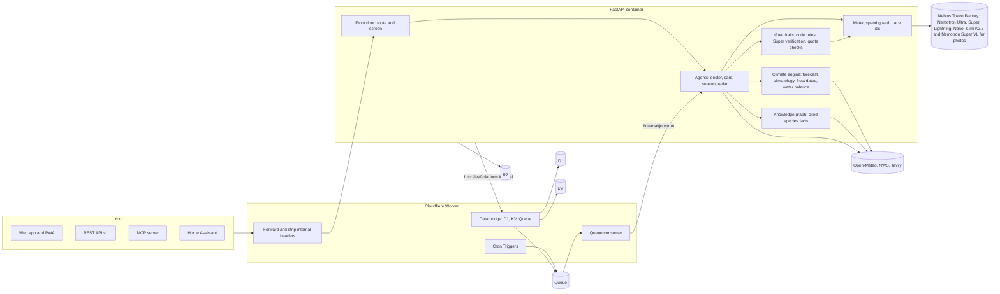
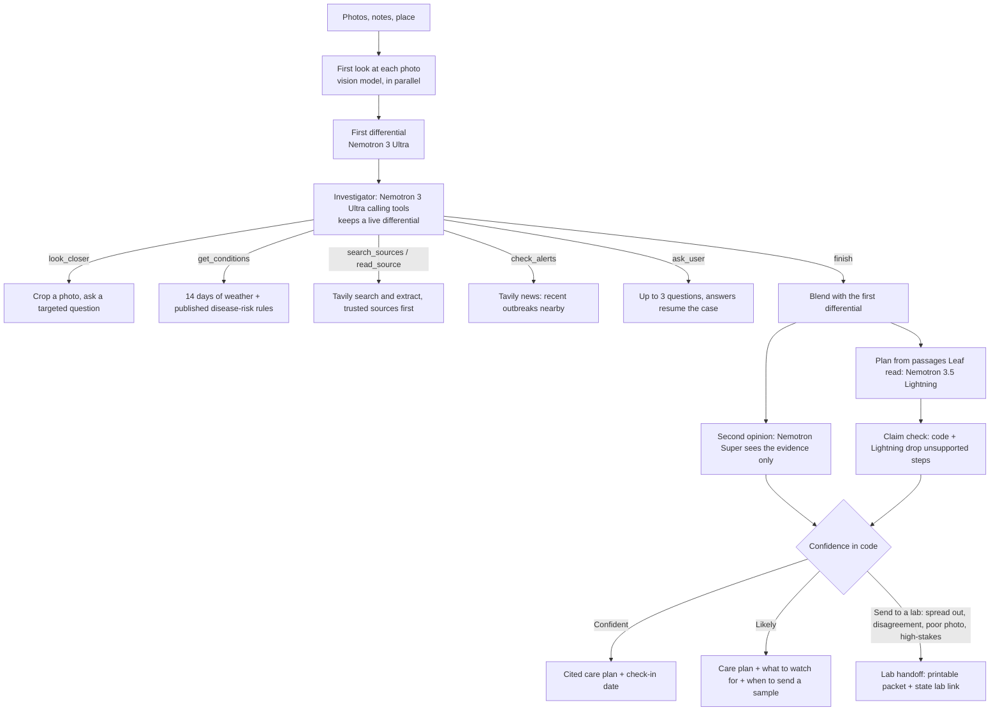

# Leaf

**A garden intelligence platform. Leaf plans your garden's day and year from your own weather, diagnoses what goes wrong, and shows the source for everything it says.**

Give Leaf your plants and a place. Each morning it works out what to water, protect, feed or check, from your local forecast, National Weather Service alerts and the published rules for each crop. It writes a week-by-week plan for the next year, checked against your frost dates. When something goes wrong, you send a photo and it works the case like a plant clinic: ranks the likely causes, reads extension-service guides, and either gives a cited care plan or hands you a case summary for your state's plant diagnostic lab. It reaches you in the browser, through an API, and from any MCP-capable AI agent.

Built for the [Nebius x NVIDIA Global AI Hackathon](https://nebiusglobalaihackathon.devpost.com/), Best Apps and Agents track, with Tavily at runtime.

**Try it:** https://leafathon.site · **How it is running right now:** https://leafathon.site/ops · **Video:** _coming soon_

## What is in it

One intelligence core (a climate engine, a plant knowledge graph, a data layer, model routing, guardrails) with five products on top.

| Product | What it does | Where |
| --- | --- | --- |
| **Care** | A daily plan per garden: water or skip (the FAO-56 water balance outdoors, a separate model indoors), frost, heat, wind and flood protection from the forecast and NWS alerts, feeding, pest scouting timed by degree days. Notifications by Web Push (an installable PWA), with quiet hours, dedupe and limits | `/today` |
| **Season Plan** | Nemotron Ultra writes 52 weeks of sowing, planting out, feeding, pruning, protection and harvest. Code rules check every item against your frost dates, temperature limits, organic and pet choices; Nemotron Super then verifies and can only remove. A frost, a diagnosis or a spreading disease replans only the affected weeks and says what changed and why. Calendar export, printable | `/season` |
| **Doctor** | Photos and notes in, a ranked differential, a cited plan and one of three verdicts (Confident, Likely, Send to a lab) out. Quick, Deep (an investigator agent with tools) and Auto. Check-ins compare new photos with old ones | `/app` |
| **Radar** | What university extension services say is being seen right now, state by state. Each report is a sentence copied from the page, checked in code, with its date and link. A matching report nudges a diagnosis by at most 5 points and can never be the reason for Confident | `/radar` |
| **Connect** | A REST API with OpenAPI, API keys with scopes and per-key limits, an MCP server, and a Home Assistant webhook where a soil-moisture sensor overrides the water estimate | `/connect` |

Also: **Identify** (name a plant from a photo, checked against cited sources, `/identify`) and **`/ops`**, a public dashboard of what the platform is doing (counts and sums only: no secrets, no personal data).

## Architecture



Everything that decides something is code: the zone, the frost dates, the water balance, degree days, disease risk, spray windows, every safety verdict and every limit. Models look, reason, write and verify; code decides, and checks the models. The container is reached by the Worker, which holds D1, KV and the queue; the container itself holds no database credentials (it reaches D1 through the Worker's outbound interception).

## What each NVIDIA model does

Every model call goes through `backend/models.py` to Nebius Token Factory. The routing table is `ROUTES` in `backend/config.py`; `/ops` shows the live mix.

| Model | Role | Used for |
| --- | --- | --- |
| **Nemotron 3 Ultra** (550B, reasoning on) | Reasoner and writer of long plans | The diagnosis and the investigator agent; the season plan (an outline of every planting date, then one call per month); replans |
| **Nemotron 3 Super** (120B) | Verifier and fallback | Verifies every season plan and replan against the code rules and cited facts, and can only remove items; checks plant identification and species facts; the second opinion in Deep; Ultra's fallback |
| **Nemotron 3.5 Lightning** | Fast volume work | The live front door (routing and the input safety screen, about 0.4 s), the care plan, claim check, chat, morning notification wording, species fact extraction, Radar's report extraction |
| **Nemotron Nano 3** | Background screening | Screens check-in notes and fetched web pages for instructions aimed at an AI reader, and triages weather alerts. It is slower than Lightning on Token Factory at the same price (1.6 s against 0.4 s median on the 65-message router eval), so nothing a user waits for uses it |
| **Kimi K2.6** (fallback: **Nemotron 3.5 Super VL**) | Reads photos | A measured decision, not a preference: on plant photos Kimi is about 16 points better first time than NVIDIA's vision model (table below), so Kimi does perception and Nemotron 3.5 Super VL is the automatic fallback when a Kimi call fails. Every other step is a Nemotron model. `CLAUDE.md` says to prefer NVIDIA unless the measured accuracy is clearly worse, and to re-measure when a new NVIDIA vision model appears |

## Numbers (measured unless it says estimated)

**What the models cost** (measured on real runs, Oct 2026; Token Factory per-token prices):

| Work | Measured | Notes |
| --- | --- | --- |
| A Quick diagnosis | under 1 cent, about 15 s | |
| An Auto diagnosis (investigates when unsure) | about 3.7 cents, about 31 s | 52-photo tune split |
| A full season plan, written and verified | $0.21, 70 to 110 s | 18 calls: 1 outline, 13 months, 4 Super chunks, in a real Minneapolis garden |
| A replan of the affected weeks, verified | about $0.011, 12 s | |
| Identifying a plant from a photo | about $0.003 | |
| A species profile (once per species, shared by every user) | 3 Tavily credits, plus a few cents of model calls | |
| A Radar run for one state | 4 Tavily credits at most, under $0.001 of model calls | |

**Estimated cost per active user per day: about half a cent** (target: under one cent). That is an estimate from the measured per-call costs above, for a user with one garden of five plants, three messages a day, one diagnosis a fortnight and two replans a month. It is not measured: Leaf has too few users for a real average, and `/ops` says so rather than printing one. The platform has a hard daily spend cap ($3 by default), a brownout at 80% (optional features fall back to rules and templates), and rules-only mode at the cap, which keeps care and alerts working.

**Accuracy:**

| Test | Result |
| --- | --- |
| **Diagnosis, 24 held-out photos** (never tuned on) | Quick with Kimi K2.6 reading the photos: right first time **50%**, in the top three **67%**; when it said Confident it was right **6 of 9** times. With Nemotron 3.5 Super VL: 33% and 46%. Details and the comparison below |
| Diagnosis, 52 licensed photos (tune split: tuned on, so optimistic) | With Kimi K2.6: Auto right first time 58%, top three 73%, Confident right 14 of 16 at the earlier thresholds. Quick: 52% and 75% (Nemotron VL: 36% and 62%) |
| Plant identification, 40 licensed photos | 92.5% right with the vision model alone, 95% after the check against sources. Well-lit, well-framed Commons photos likely seen in training, so a ceiling rather than what a phone photo gets |
| Front-door router, 65 labelled messages (attacks, toxicity questions, real garden questions) | 0 false refusals, 0 of 6 harmful requests missed, 0 to 1 of 7 prompt injections missed, intent 97% (Lightning) |
| Hardiness zone from 30 years of ERA5-Land, five US cities | Within half a zone of the USDA map in all five, exact in none |
| Radar, real runs on Oct 15 2026 | Most states have little current: Minnesota's pages had no current report, Michigan's site blocks the page reader, and Pennsylvania's final production run kept none (a debugging run found one valid corn earworm report). A first production run stored a wrongly attributed report; the real run found it and the check was tightened. Radar says "nothing current" rather than guess |

**Speed in production** (a real headless browser, after the deploy): the first byte in 73 to 280 ms, each page loaded with its data in 206 to 513 ms at phone width, API calls 63 to 588 ms (Today is the slowest because it plans the garden on demand); a Quick diagnosis through the API took 8 s, an Auto diagnosis of a high-stakes disease 38 s; the first load after a deploy took 8 s while the container started.

**Tests:** 820+ offline tests with scripted fake models and search (`make test`; they never spend credits), a type check of the Worker, lint. CI runs `make check`; while GitHub Actions billing is broken it is run locally before every push.

**Not yet verified live:** the MCP server from a real MCP client (it is tested with the raw JSON-RPC calls such a client sends, in both protocol versions), the Home Assistant webhook from a real Home Assistant, and a Web Push notification on a real phone. Each is built, tested offline and, where it could be, checked against the real services.

## Leaf Doctor

**Auto** (the default; 15 seconds to about a minute, about 4 cents on average) runs Quick first, and opens a Deep investigation only when Quick is not confident, seeded with Quick's look at the photo so nothing is repeated. **Quick** (about 15 seconds, under a cent) is one careful look at the photo, a structured diagnosis by Nemotron 3 Ultra, Tavily search, and a care plan by Nemotron 3.5 Lightning. **Deep** (about 40 seconds, about 5 cents) is an investigator agent working the case with tools, streamed live.

Every answer ends in one of three verdicts, decided in code (`backend/verdict.py`), never by the model:

| Verdict | When | What you get |
| --- | --- | --- |
| **Confident** | the leading cause is well ahead, the photo is usable, nothing high-stakes is in play | a cited care plan |
| **Likely** | a clear favourite, but a weaker lead, a close second, or a second opinion that leans elsewhere | the care plan, what to watch for, and when to send a sample |
| **Send to a lab** | the causes are spread out, the photo is too poor, the second opinion strongly disagrees, or a high-stakes condition is in the top two or at 20% or more anywhere | a printable case summary and your state's plant diagnostic lab |

High-stakes conditions are the ones where a wrong guess hurts more than the gardener's plant: late blight, tomato brown rugose fruit virus, sudden oak death, citrus greening, Ralstonia race 3 biovar 2, boxwood blight, spotted lanternfly and box tree moth, each with its APHIS or extension source in `backend/diseases.py`.



The investigator's tools are all read-only: `look_closer`, `get_conditions` (14 days from Open-Meteo through published rules: TOMCAST for tomato; Hutton, Smith and Wallin for potato, each threshold cited in `backend/disease_rules.py`), `search_sources`, `read_source` (only URLs this case's own searches returned; no URL a model writes is ever fetched), `check_alerts`, `ask_user` and `update_differential`/`finish`. **Enforced in code:** 8 counted tool calls, per-tool caps, a dollar budget, a hard 90-second clock with a forced finish, an Ultra-to-Super fallback per turn, and a fall back to Quick if the investigation fails. Probabilities are capped at 0.9.

**Which model reads the photos: a measured decision.** On Oct 15 Token Factory started listing `nvidia/Nemotron-3.5-Super-VL`, an NVIDIA vision model, and Leaf's all-NVIDIA pipeline was tempting. We measured it against Kimi K2.6 on the same photos, same code, Quick mode with search off (the diagnosis and its confidence come before the search, so scores are the same and no Tavily credits are spent):

| Photo model | Tune split, 52 photos: top-1 / top-3 | Held-out, 24 photos: top-1 / top-3 | Held-out: Confident was right | Held-out Brier |
| --- | --- | --- | --- | --- |
| **Kimi K2.6** (pinned) | **52% / 75%** | **50% / 67%** | 6 of 9 | 0.295 |
| Nemotron 3.5 Super VL (fallback) | 36% / 62% | 33% / 46% | 3 of 7 | 0.363 |

The held-out split is 24 photos (12 diseases, 6 pests, 6 nutrient, weather or other problems; `evals/README.md` lists every photo, author, licence and the rules that keep it clean). Kimi is about 16 points better first time on both splits, so the gap is the model, not luck or overfitting (Kimi scored about the same on the tune and held-out photos). Nemotron's observations are shorter and miss the specifics the diagnosis needs, for example "concentric rings" on early blight. On the tune split only we tried to close the gap with thinking on for the vision step (40% top-1, 52% top-3), larger images at 1568 px (33%, 58%) and a prompt that demands specifics (31%, 50%); none beat the default (36%, 62%) beyond noise. A gap of a few points would have kept all-NVIDIA; 16 points does not, so Kimi does perception, Nemotron VL is the automatic fallback, and every other step is a Nemotron model. The result is also written up as feedback for NVIDIA in `docs/FEEDBACK.md`, with the steps to reproduce it.

**"Confident", fitted on the tune split only.** With Kimi, Quick says Confident only at 0.85 with a lead of 0.3, the strictest level where it was right on every tune case (6 of 6, and 4 of 4 on a second tune run); Deep says it at a combined 0.65 (7 of 7 on tune). The earlier looser levels were 11 of 12 and 7 of 8. **On the held-out photos the strict Quick level was still right only 6 of 9 times**, so even a fit that is perfect on the tune photos over-claims on new ones. We show that rather than hide it. When Nemotron VL is the one that read the photo (the fallback), no threshold reached 85% on the tune split (2 of 4 at 0.8 or 0.85, 0 of 1 at 0.9), and Deep with it could not be fitted inside the credit budget, so neither mode says Confident then: Leaf says Likely or Send a sample to a lab.

**Auto on the held-out photos** was run only with Nemotron 3.5 Super VL, before Kimi was pinned; Auto with Kimi has not been measured on this split (it costs about 25 Tavily credits).

| Run | Photo model | Top-1 | Top-3 | When it said Confident | Brier | Cost / case |
| --- | --- | --- | --- | --- | --- | --- |
| Auto, first run | Nemotron 3.5 Super VL | 33% | 50% | right 6 of 9 | 0.183 | $0.031 |
| Auto, second run | Nemotron 3.5 Super VL | 46% (11 of 24) | 50% | right 2 of 4 | 0.282 | $0.042 |

**The second Auto run saw the same 24 photos as the first.** Between the two runs the only change was to the verdict thresholds, which can change which cases get investigated but not what the vision model sees, so it is a second look at the same photos, not a fresh test. Earlier in the project repeat runs of the same mode varied by several points, and one photo here is about 4 points, so the gain from 33% to 46% should not be read as an improvement. Read the two runs together, not the better one. Deep was not run on this split. Answers are scored by name, so some near-misses count as wrong ("Iron deficiency" for iron chlorosis, "Septoria" for cercospora); the scoring was not changed after seeing results. Every run on the held-out split is listed in `evals/README.md`.

**Tune split, 52 licensed photos** (31 diseases, 15 abiotic problems, 6 pests). These were used to tune Leaf, including the verdict thresholds, so the numbers are optimistic. One run per mode, 13 October 2026:

| Mode | Top-1 | Top-3 | When it said Confident | Likely right | Sent to a lab | Brier | Cost / case | Time / case |
| --- | --- | --- | --- | --- | --- | --- | --- | --- |
| Quick | 52% | 75% | right 11 of 12 | 15 of 37 (top-3: 25) | 3 (6%) | 0.264 | $0.009 | 16 s |
| Deep | 56% | 73% | right 7 of 8 | 14 of 24 (top-3: 18) | 20 (38%) | 0.210 | $0.054 | 40 s |
| **Auto** | **58%** | 73% | **right 14 of 16** | 10 of 23 | 13 (25%) | **0.204** | $0.037 | 31 s |

Auto's row is live; Quick's and Deep's verdict columns replay their logged runs through the final thresholds, which were fitted on those same runs, so they flatter Quick and Deep slightly. Read plainly, on the tune split: Auto is the default because it beat Quick there (58% against 52%, better calibrated, about four times the cost), but on 52 cases one case is about 2 points and repeat runs vary by several, so that is a modest lead, not a proven one. "Confident" means something (14 of 16 in Auto). "Likely" is where the misses are, which is why it comes with what to watch for. Late blight is Leaf's most common miss: Auto once said Confident: powdery mildew on a late blight leaf, because the vision model reported a white coating that was not there. A structured symptom checklist in the vision step did not help (48% with it, 52% without), so it is off. `scripts/eval.py` reruns all of this; `docs/ACCURACY_AUDIT.md` examines every miss.

## After the diagnosis, and the plant journal

Three tools for actually saving the plant, each decided in code rather than by a model:

- **Organic and pet-safe plans.** Tick "Organic methods only" or "Pets or children use this garden". The plan writer is told, and then every step is checked in code against a table of 33 active ingredients (`backend/actives.py`): organic or not (USDA National Organic Program actives), risk to pets, harm to bees. Steps that break your choice are removed and listed with the reason. Plan-wide warnings cover oil with sulfur (leaf burn), bee-harming products (spray at dusk) and what to do if a pet eats a treated plant. The Season Plan uses the same table.
- **The best time to spray** (`backend/spray.py`). When a plan applies a product, Leaf scores every daylight hour of the next five days of forecast: leaves dry, at least 6 dry hours after, wind at most 16 km/h with gusts at most 24 km/h, between 7 °C and a heat limit that drops from 32 °C to 29 °C with oil or sulfur, and only early morning or evening for bee-harming products. It suggests the best 3-hour window and shows the five-day grid.
- **My plants and reminders** (`/plants`). Every report you save is listed on your device with its verdict, last check-in and the date to check again. Add a check-in or a spray window to Google, Apple or Outlook calendars (the `.ics` links can only point at Leaf pages). A private link moves the list to another device; there is no account.

Every finished report is saved for 30 days under an unguessable link (`/c/<id>`) you can share. Come back with a new photo to check in: Leaf compares it with the last one (spreading, stable or recovering), updates the advice and escalates anything still spreading. Only small thumbnails are kept, never your full uploads. A report linked to a garden plant also becomes tasks and a replan of the season plan, and its check-ins close that loop.

## Care and Today

Each morning, once per populated time zone, Leaf plans every garden: **water or skip** per plant (the FAO-56 water balance from forecast evapotranspiration and rain outdoors; a separate heuristic for houseplants, which the weather never waters), **frost** protection when tonight's low is 2.2 °C (36 °F) or below or an NWS frost or freeze alert starts by tomorrow morning, **heat** protection at 32.2 °C (90 °F), **wind** and **flood** from the forecast and alerts, **feeding** only when a verified fact says how often, **pest scouting** when degree days reach a published threshold (Japanese beetle, squash vine borer, cabbage maggot and three more, each with its extension source), and weekly photo check-ins. An afternoon check at 14:00 warns of frost or heat before dark. Every task has a reason, a due time and a source, or says it is Leaf's own rule.

Models add little here by design: Lightning only words the morning notification, and code rejects its wording if it names a number or a plant that the tasks do not. Notifications go to the channels the gardener chose, with quiet hours, dedupe and a daily limit; urgent alerts skip quiet hours, because a freeze warning held until 07:00 comes too late.

## Season Plan

Ultra fixes every planting date in one call, then writes each month in its own call around them (a month too cold for anything gets no call). Code checks every item: planting out before the earliest date for the plant's frost class (CSU Extension's hardy, semi-hardy, tender, very tender, counted from the 30-year average last frost) is removed, as is a month too cold for it, a product the garden's organic or pet choices exclude (`backend/actives.py`), and a repeated pest check every week. Super then verifies in chunks and can only remove. The plan the gardener sees is the verified one; a rewrite keeps it on screen until the new one is ready, and months are saved as they are written, so a retry after a timeout writes only what is missing.

A real production check found a bug the offline tests did not: the outline put a tomato transplant in the week of the earliest allowed date, the rules allowed it with a caution, and Super then removed it, so the plan never planted the tomato out. It is fixed with a rule and a test, and `docs/LEAF_PLATFORM.md` records it.

## Radar

Once a week for each US state that has a garden, Leaf searches that state's university extension sites (a table of 50 hosts in `backend/radar/regions.py`; Louisiana, Michigan and Oklahoma could not be opened by the checker and are marked), reads the pages, and keeps a report only when the page has its own recent date, says a specific pest or disease was seen, and contains the quoted sentence word for word. Every step that decides is code: the page's date is found in code, the quote must be in the page, must name the pest and say it was seen (a sentence about what might happen is rejected), and a page about another state is rejected. Nano 3 screens each page for text aimed at an AI reader first. Nothing is seeded or written from memory.

A report nudges a diagnosis only through `backend/radar/prior.py`: two points per distinct source, at most five, only for a candidate that names the same pest on the same kind of plant. The verdict is decided twice, without and with the prior, and the more cautious stands, so a prior can send a serious case to a lab but can never make Leaf confident by itself.

## Connect

- **REST API v1** (`/api/v1`, OpenAPI at `/api/v1/openapi.json`): garden, today, season plan, readings, diagnose, identify, weather risk. Keys belong to a garden, are shown once, stored only as a hash, and carry scopes (`read`, `readings`, `tools`) and limits per hour, per day and for calls that spend model credits, counted in D1.
- **MCP** (`/mcp`, Streamable HTTP, no sessions): `diagnose`, `identify`, `care_plan`, `season_plan`, `weather_risk`. It serves both the 2025 `initialize` handshake and the current stateless 2026-07-28 protocol, written from the specification pages.
- **Home Assistant**: `POST /api/v1/readings`. A reading under 12 hours old replaces the weather estimate for its plant. A test reading is labelled TEST wherever Leaf uses it.
- A Telegram bot was built and then cancelled by the maintainer on 2026-10-15; its code was removed.

## Platform engineering

- **Where it runs**: Cloudflare Workers and Containers, with D1 (data), KV (caches), Queues (jobs with a dead-letter queue), R2 (reports) and Cron Triggers. The container reaches D1 through the Worker's outbound interception, so it holds no database credentials. Every model call still goes to Nebius Token Factory.
- **Jobs**: the Worker's crons fan work out per region and enqueue it; the queue consumer wakes the container only when there is work. Every job is idempotent, retried with backoff, and recorded in D1. The schedule is in `docs/LEAF_PLATFORM.md`.
- **Cost engineering**: forecasts are cached per 0.1° cell per hour, climatology once per cell for good, species profiles once per species for every user, Radar once per state per week. Open-Meteo's free allowance is counted in D1 and Leaf stays under 8,000 of the 10,000 daily units; Tavily credits are sized each day from the live monthly balance. Every model call is metered by task, model, tokens, cost and latency under a trace id.
- **Guardrails**: code rules for chemicals, organic, pet, child and bee choices, verdict thresholds and escalation; Super verifies plans; web text is untrusted data inside delimiters and checked in code (quotes must be on the page; nothing a model writes is fetched); the front door screens every message (code first, then a model).
- **Free data and services**: Open-Meteo (CC BY 4.0), NWS and Tavily within its credits cost nothing. Hosting is Cloudflare Workers Paid (Containers require it), which is the one paid plan; model calls use the hackathon's Token Factory credits.

## Nebius and NVIDIA usage

- **Nebius Token Factory**: every model call (OpenAI-compatible API, `backend/models.py`), including native tool calling for the investigator and live per-token prices from `/models` for the cost meter.
- **NVIDIA Nemotron 3 Ultra, Super, 3.5 Lightning and Nano 3**: every reasoning, writing, verification and screening step (the table above).
- **Hosting**: Cloudflare Containers (`cloudflare/`, `make deploy-cloudflare`). Cloudflare only hosts the app.
- **Tavily**: search, extract and news at runtime (`backend/search.py`, `backend/tools.py`, `backend/radar/`).
- **Open-Meteo** and **NWS**: weather, climatology and alerts. Weather data by [Open-Meteo.com](https://open-meteo.com/) (CC BY 4.0).

## Run it

Requirements: Python 3.11+, a Nebius Token Factory API key, a Tavily API key.

```bash
git clone https://github.com/risshabs22-quantified/leaf.git && cd leaf
make setup          # creates .venv and the env file
# add NEBIUS_API_KEY and TAVILY_API_KEY to the env file
make smoke-all      # checks keys, models, regions, vision model (under 1 cent + 1 Tavily credit)
make run            # http://localhost:8000
```

Other commands: `make test` (offline tests, no credits), `make check`, `make eval`, `make eval-router`, `make docker-build`, `make deploy-cloudflare`. See `make help`. Settings are in `.env.example`.

## Project layout

```text
backend/    FastAPI app (app.py); Token Factory client (models.py); routing table (config.py)
  data/       D1 or SQLite repository, migrations, KV, the Worker bridge
  climate/    forecast, climatology, frost dates, NWS, risk, water balance, crops
  knowledge/  species profiles with verified facts, plant identification
  care/       the daily planner, pests, sensor override
  season/     season plans: rules, writing, verification, replanning, Doctor wiring
  radar/      regions, collection, regional prior
  connect/    API keys, REST API v1, MCP, management endpoints
  notify/     the notifications service, Web Push
  pipeline.py, deep.py, agent.py, tools.py, critic.py, claims.py   Leaf Doctor
  jobs.py, platform_api.py, metering.py, router.py, cache.py        platform
frontend/   static pages and scripts, no build step
cloudflare/ the Worker (cron fan-out, queue consumer, data bridge) and its config
migrations: backend/data/migrations/0001 to 0007
tests/      offline tests with scripted fake models, tools and search
scripts/    smoke test, evals, calibration, deploy, VAPID setup
evals/      labelled photo cases and their licences; the front-door router eval
docs/       LEAF_PLATFORM.md (architecture, limits, decisions, milestones), PROGRESS.md
```

## Safety

Leaf gives guidance, not certainty. Plans are written only from passages Leaf actually read; a claim check drops any step whose cited source does not support it and any rate or dose that is not in the cited passage, and every chemical step tells you to follow the product label. In code, any low-confidence diagnosis, near-tie, poor photo or disagreeing second opinion escalates to a lab handoff. Weather-based indices are risk signals estimated from modelled humidity, never proof of disease. Plants a garden marks as for pets or children never get a step that the organic and pet table forbids, and toxic plants carry a precaution with its source.

The public demo protects itself and its credits: uploads are size- and pixel-limited, request bodies are capped before they are read, every case runs under a concurrency cap and a deadline, per-IP, per-garden, per-key and daily limits apply, and the spend cap holds. User text, web text and model-written text are sanitised before they enter a prompt and treated as data, not instructions. Photos are not logged; locations are rounded; a garden has no account, only a private link whose key is stored as a hash.

## Feedback on Nebius and NVIDIA

The full write-up, with reproduction steps, impact and a suggestion for each item, is in [`docs/FEEDBACK.md`](docs/FEEDBACK.md). The short version:

- **Do not combine `tools` with `response_format`**: Ultra silently stops calling tools.
- **The thinking switch differs by model family**: Nemotron reads `enable_thinking`, Kimi reads `thinking`. The right key made our vision step 3x faster and 4x cheaper.
- **The public catalog listed Super as `error`** while it answered every request.
- **No NVIDIA guard, embedding or reranker model is served.** An NVIDIA vision model, Nemotron 3.5 Super VL, appeared on 15 October but reads plant photos about 16 points worse than Kimi K2.6 (see Numbers), so Kimi stays the photo model.
- **Reasoning tokens count toward `max_tokens`**, which returns empty or truncated JSON unless budgets are generous (a 3,000-token budget for Super's verification ran out while it reasoned; 8,000 with smaller chunks fixed it).
- **Nemotron 3.5 Lightning returned an empty list for a clear sighting** in Radar's extraction until the prompt carried a worked example; Super found it without one.
- `tool_choice="required"` produced duplicate calls; Nemotron sometimes answers in prose or invents tool names mid-agent; run-to-run variance at temperature 1.0 is large; there is no cached-input price for agent loops.
- What worked well: native tool calling (1-2 s per turn, parallel calls), separate `reasoning_content`, and per-token prices in `/models?verbose=true`, which power Leaf's live cost meter.

## License

Leaf's code is [MIT](LICENSE). The evaluation photos in `evals/images/` are **not** MIT: each file keeps its own Wikimedia Commons licence (CC0, public domain, CC BY or CC BY-SA), and `evals/README.md` lists the author, source link, licence and changes for every file.
