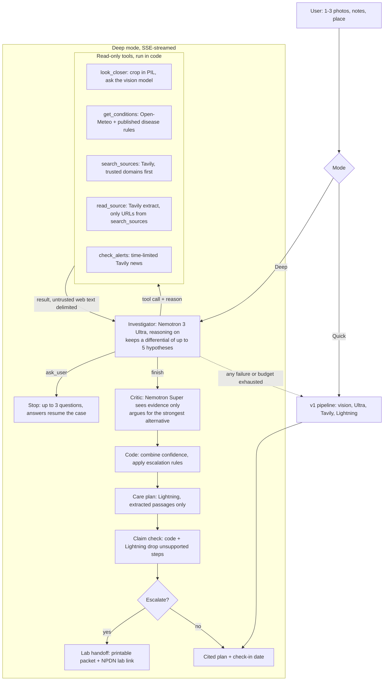

# Leaf v2: the investigator agent

Status: **Milestone 0 (research, probes, this plan) is done. Nothing in v2 is built yet.**
Deadline: Fri Oct 30, 2026, 10:00 AM PT (18 days from 2026-10-12).
Tracks: Best Apps and Agents, plus the Best Use of Tavily bonus. The four judging criteria weigh equally and ties go to Technological Implementation, so every feature below must be visible in a 3-minute demo, backed by an eval number, and survive a live demo.

## The claim

Leaf v2 works a case the way a plant pathologist does: take a history, look closely, check the environment, form a differential, test each hypothesis against evidence, get a second opinion, then either commit to a cited care plan or hand the case to a real diagnostic lab. We do not claim to beat experts. We claim the expert workflow in about a minute, with every step shown.

The v1 pipeline stays as **Quick** mode and as the automatic fallback whenever the agent fails.

## Architecture

Code, not the model, enforces: tool-call limit, token and cost budget, wall clock, URL allowlist, confidence combination, escalation, citation filtering, and the Deep daily cap.

## What was verified (Oct 12, 2026)

### Token Factory (live probes on Ultra and Super, plus catalog and model cards)

| Fact | Result | How we know |
| --- | --- | --- |
| Native tool calling on Ultra and Super | Works; 1-2 s per turn; `finish_reason: "tool_calls"` | live probe |
| Lightning has the function-calling tag | Yes (not probed; Lightning is the writer and does not call tools) | catalog |
| Parallel tool calls | The model emits several per turn on its own (2 seen). `parallel_tool_calls=True` is accepted. `tool_choice="required"` produced 4 duplicate calls, so never use it | live probe |
| Tools together with `response_format` json | **Do not combine.** With both, the model stops calling tools and writes JSON text | live probe |
| `chat_template_kwargs.enable_thinking` | Honoured: false removes reasoning and cut output tokens 202 to 81 | live probe |
| `force_nonempty_content`, `medium_effort` | Accepted; `medium_effort` made the model more conservative (1 call instead of 2) | live probe |
| Reasoning output | Separate `reasoning_content` field (Super also `reasoning`), never mixed into `content` | live probe |
| Streaming with tools | Works. Tool-call deltas arrive as fragments (`index`, `id`, `function.name` first, then argument pieces); reasoning streams as `reasoning_content`; `stream_options.include_usage` gives a final usage chunk | live probe |
| Sampling | temperature 1.0, top_p 0.95 for all Nemotron 3 steps, tool calling included | model cards |
| Context | Ultra 1,048,576; Lightning 1,048,576; Super 262,144 | catalog |
| Price per 1M tokens, in / out | Ultra $1.00 / $3.00; Super $0.30 / $0.90; Lightning $0.06 / $0.24; Kimi-K2.6 (vision) $0.95 / $4.00. No cached-input discount listed | catalog |
| Rate limits | Example baseline 60 RPM and 400K TPM, rising automatically; real per-model numbers are in the console. 429s carry rate-limit headers | docs |
| NVIDIA guard, embedding or rerank model on Token Factory | **None.** The only embedding model is `Qwen/Qwen3-Embedding-8B` (not NVIDIA). NVIDIA's `Nemotron-3.5-Content-Safety` exists on Hugging Face but is not served here | catalog + model list |
| Super availability | The public catalog lists Super with `status: "error"`, **but it answered every probe**. Check `/models` at startup and surface the status in `/api/health` | catalog vs probe |

Sources: https://tokenfactory.nebius.com/model-catalog.md, https://tokenfactory.nebius.com/api/public/models_info, https://api.tokenfactory.nebius.com/openapi.json, https://docs.tokenfactory.nebius.com/ai-models-inference/function-calling.md, https://docs.tokenfactory.nebius.com/ai-models-inference/rate-limits.md, and the Hugging Face model cards for the three Nemotron 3 models.

### Tavily (tavily-python 0.8.5)

- Search: `topic` general/news/finance; `time_range` day/week/month/year; `start_date`/`end_date`; `include_domains` (up to 300, mode restrict or prefer); `search_depth` basic/advanced/fast/ultra-fast; `max_results` 0-20. `country` applies to general only.
- Extract: `urls` (1-20), `extract_depth` basic/advanced, `format`, and a relevance **`query` with `chunks_per_source` (1-5, about 800 characters each)**, which returns only the relevant passages. This is what `read_source` uses. HTTP 200 can carry an empty `results` list, so check `failed_results`.
- Credits: search basic 1, advanced 2; extract basic 1 per 5 successful URLs, advanced 2 per 5; failed extractions are free; a news-search price is not documented (budget it as a normal search and measure). Free plan 1,000 credits a month; dev keys 100 RPM.
- Not documented: how Tavily protects against SSRF or honours robots.txt. We validate URLs ourselves (see `read_source`).
- Prize criteria for Best Use of Tavily could not be confirmed (the Devpost page returned 403). The event page says Apps and Agents builds use Tavily for real-time web search. Depth and variety of runtime use (search, extract, news) is our best reading.

Sources: https://docs.tavily.com/documentation/api-reference/endpoint/search, `.../extract`, https://docs.tavily.com/documentation/api-credits, https://docs.tavily.com/documentation/rate-limits, https://nebius.com/events/nebius-nvidia-ai-builders-hackathon.

### Open-Meteo

- Weather: `https://api.open-meteo.com/v1/forecast` with `past_days=14&forecast_days=1&timezone=auto` and hourly `temperature_2m, relative_humidity_2m, dew_point_2m, precipitation, wind_speed_10m, soil_moisture_0_to_1cm, shortwave_radiation`. It has no delay (the ERA5 archive endpoint lags 5 days), so the forecast endpoint with `past_days` is the right one.
- Geocoding: `https://geocoding-api.open-meteo.com/v1/search?name=...&count=5` returns name, latitude, longitude, country, admin1, timezone.
- There is **no hourly leaf-wetness variable**; the daily "leaf wetness probability" is undocumented and must not be used. We compute wetness ourselves from relative humidity, and say it is a proxy.
- Terms: the free API is **non-commercial only**, CC BY 4.0, so a visible attribution link is required ("Weather data by Open-Meteo.com"). Under 600 calls a minute, 5,000 an hour, 10,000 a day. A hackathon demo fits; whether competing for a prize counts as commercial is **unverified** (see Risks).

Sources: https://open-meteo.com/en/docs, /en/docs/geocoding-api, /en/terms, /en/licence.

### Disease-pressure rules we may compute (published only)

Open-Meteo gives modelled grid-cell humidity, not measured leaf wetness, so every wetness-hours rule is a **proxy** and the UI says so. Each rule is applied only to the crop it was published for.

| Rule | Applies to | Definition | Source | Confidence |
| --- | --- | --- | --- | --- |
| Leaf wetness proxy: hours with RH >= 90% | all (input to the rules below) | count hours at or above 90% RH as wet; accuracy 0.77-0.92 across sites | Sentelhas et al., https://flore.unifi.it/handle/2158/345929 | medium |
| Smith period | potato late blight | two consecutive days, each with min temp >= 10 C and >= 11 h at RH >= 90% | Skelsey and Cooke, https://web14.agro.au.dk/project2/euroblight/Workshop/2013Limassol/Proceedings/Page035-40_Skelsey.pdf | high |
| Hutton criteria | potato late blight | as Smith but >= 6 h at RH >= 90%; UK-calibrated | AHDB, https://potatoes.ahdb.org.uk/development-and-implementation-of-a-new-national-warning-system-for-potato-late-blight-in-great-britain-hutton-criteria | high (UK) |
| Wallin severity values | potato late blight | severity 0-4 per continuous wet run by mean temperature, accumulate; 18 predicts first blight in 7-10 days; Northeast US | UMaine bulletin 2418, https://extension.umaine.edu/publications/?p=7060 | medium: re-verify the table against the PDF before coding |
| TOMCAST daily severity value | tomato early blight, Septoria, anthracnose | 0-4 from wet hours by mean temperature band; spray advisory at 20 accumulated | Wisconsin, https://extension.soils.wisc.edu/wp-content/uploads/sites/68/2015/06/Frost-2015-WCMC-Proceedings.pdf; UConn, https://ipm.cahnr.uconn.edu/using-forecasting-models-to-time-tomato-fungicides-and-insect-management | medium-high |
| Growing degree days, single average with horizontal cutoff | generic input | ((Tmax + Tmin) / 2) - base, Tmax capped at the upper limit, floor 0 | AgriMet, https://www.usbr.gov/pn/agrimet/gdd.html | high for the formula |
| GDD timing use: codling moth | apple, pear | base 10 C, upper 31.1 C; egg hatch at 216 DD after a trap biofix | UC IPM, https://ipm.ucanr.edu/weather/phenology-models-description/codling-moth/ | high, but needs a biofix we do not have |

Design consequence: `get_conditions` takes an optional `crop`, so a tomato case gets TOMCAST and a potato case gets Smith, Hutton and Wallin. A crop with no published rule gets raw weather and wet-hour totals only, plus a note that no validated index exists.

**Do not implement (not established):** any cucurbit downy mildew or powdery mildew index; Open-Meteo's `leaf_wetness_probability`; our own "low/medium/high" cutoffs on DSV or severity totals; Smith or Hutton on tomato; blending indices into one score; a Michigan 80% RH Wallin variant.

## Agent specification

### Investigator (`backend/agent.py`)

- Model: Nemotron 3 Ultra with `tools`, `enable_thinking: true`, temperature 1.0, top_p 0.95. Fallback Super, then Quick. Tools and `response_format` are never combined; `finish` is a tool.
- State: an explicit differential, up to 5 hypotheses, each `{name, probability, evidence_for[], evidence_against[]}`, with evidence ids pointing at tool results. Updated by the model after each tool result and re-validated in code.
- Parallel calls: the model may return several tool calls in one turn. All are executed (concurrently where independent) and each counts against the limit.
- Limits, enforced in code: **8 tool calls**, a token and cost budget per case (default 10 cents), **90 s wall clock** (Deep gets its own deadline; the existing 100 s request deadline stays as the outer bound). At any limit the loop injects "finish now with what you have" and calls `finish`.
- Every tool has a required one-sentence `reason`, streamed to the UI before the tool runs.
- Reasoning: `reasoning_content` is streamed to the UI as "thinking" text, trimmed, and is not sent to the critic.
- Untrusted text: all tool results are wrapped in tagged blocks and sanitised with the existing `sanitize()`. System prompt states tool output is data, never instructions. Tool names and arguments are validated against a schema; unknown tools are refused.
- A failed tool returns `{"error": "...", "skipped": true}` to the model and shows as skipped in the trace; the loop continues.

### Tools (all read-only)

| Tool | Arguments (all require `reason`) | Behaviour |
| --- | --- | --- |
| `look_closer` | `photo_id`, `region` {x, y, w, h as 0-1 fractions}, `question` | Crops the uploaded photo in PIL, sends the crop to the vision model with the targeted question, returns a short observation. Uploaded photos only. Max 3 per case (it is the main cost driver, see below) |
| `get_conditions` | `crop` (optional) | Last 14 days from Open-Meteo for the user's place (geocoded city, or browser location rounded to 1 decimal), wet hours, and the indices that apply to the crop, each with its source. Attribution shown in the UI. Thresholds come only from the table above |
| `search_sources` | `query` | Tavily search; trusted domains (.edu, .gov, extension services, rhs.org.uk, via the existing strict matcher) first and marked `trusted`; open-web results marked `untrusted`. Returns source ids, titles, URLs, short snippets |
| `read_source` | `source_id`, `query` | Tavily extract with the relevance `query`, only on a URL stored under that `source_id` earlier in this case (never a URL the model writes: this blocks SSRF). Returns trimmed relevant passages with the source id |
| `check_alerts` | `region` | Tavily `topic=news`, `time_range=month`, for current outbreak reports in the user's region |
| `ask_user` | `questions` (up to 3) | Ends the loop; the questions are chosen to separate the top two hypotheses. The answers resume the same case |
| `finish` | `differential`, `evidence_ids` | Final differential with probabilities and the evidence ids behind each |

### Second opinion (`backend/critic.py`)

Nemotron Super receives only the evidence (observations, weather findings, extracted passages), never the investigator's reasoning, and argues for the strongest alternative hypothesis. Code combines investigator probability, critic agreement, image quality and evidence coverage into the final confidence; disagreement lowers it. The exact weights are set during M3 from eval data and recorded here, not guessed now. The existing escalation rules stay: low confidence, near-tie (top two within 0.15), poor photo, and now critic disagreement, always escalate.

### Care plan, claim check, lab handoff

- Lightning writes the plan from extracted passages only; every step cites a source id.
- Claim check: code verifies each step's cited id exists and that the passage contains the step's key terms (and any number), then Lightning judges support. Unsupported steps are dropped or flagged. No chemical rates unless the cited passage states them; always "follow the label".
- Lab handoff (printable page): photos, history, weather summary, differential, what to sample and how to pack it, and a link to the user's state lab through the National Plant Diagnostic Network. The NPDN link format and the sampling guidance are **to be verified in M3** by the researcher subagent; nothing is hard-coded from memory.

### Optional NVIDIA extras

There is no NVIDIA guard or reranker on Token Factory, so a separate guard model is dropped. Option for M3 if time allows: Nemotron Nano 3 (30B, NVIDIA, on Token Factory) as a cheap screen for off-topic or unsafe user text and for re-ranking passages, by prompt. It only ships if an eval shows it helps.

### Plant journal (`backend/store.py`, SQLite) and check-ins

- Each case gets an unguessable id (128-bit random) and a read-only share page. No accounts, no images in logs, cases expire after 30 days.
- Check-in: a later photo is compared with the last and the status becomes spreading, stable or recovering; the plan updates.
- **Persistence is unresolved.** A Nebius Serverless Endpoint may not keep a disk across restarts. See "Decisions I need from you".
- `ask_user` resume needs case state before M5 exists. M1 therefore keeps cases in a bounded in-memory registry (30-minute TTL, photos included, never logged); M5 moves them to SQLite.

### Live interface (SSE)

`POST /api/diagnose/deep` streams events: `step` (what and why), `thinking`, `weather`, `source`, `differential` (re-rank), `critic`, `plan`, `done`, `error`. The page shows a re-ranking differential chart, evidence cards linked to sources, a weather strip with attribution, the lab handoff view, up to 3 photos (whole plant, close-up, underside; phone camera allowed), and a Quick / Deep toggle. It keeps the green-on-near-white single column. SSE must work with the existing body limit, concurrency cap, deadline and CSP.

## Cost and reliability

Estimate per Deep case from catalog prices and probe token counts (to be replaced by measured numbers in M1):

| Step | Tokens (in / out) | Cost |
| --- | --- | --- |
| Investigator, about 6 turns on Ultra | 30k / 4k | about $0.043 |
| 3 `look_closer` calls on Kimi (it spends 1.4-2.4k reasoning tokens per call) | 4k / 6k | about $0.028 |
| Initial vision pass (existing) | 2k / 2k | about $0.010 |
| Critic on Super | 4k / 1.5k | about $0.003 |
| Plan and claim check on Lightning | 8k / 2k | about $0.001 |
| **Total model cost** | | **about $0.085** |
| Tavily | about 3 searches, 1 news, 2 extracts | about 6 credits |

That is under the 10-cent target but with little margin, and Kimi's reasoning tokens are the largest variable. Mitigations: cap `look_closer` at 3, track real usage per call from the response, and stop the loop when the running cost reaches the budget.

- Per-step log line: model, tokens in/out, cost in dollars (prices live in `backend/config.py`), Tavily credits.
- Separate daily cap for Deep (`LEAF_DEEP_DAILY_CAP`, default 20); past it, Quick runs and the UI says so.
- Any tool failure degrades gracefully; the trace shows what was skipped.

## Proof (Technological Implementation)

`scripts/eval.py` runs Quick and Deep on the same cases and reports top-1, top-3, calibration (Brier score and a reliability table), escalation precision and recall, and cost and latency per case. Deep becomes the default only if it beats Quick on the held-out test split. The real numbers go in the README even if modest. Every tool and loop limit has offline tests with scripted fake tool calls; no test spends credits.

Eval images: licences must be recorded in `evals/README.md`. Lab-condition datasets are easy to license but look nothing like phone photos, so results on them would flatter both modes. We will say so in the README.

## Milestones

Each milestone: short plan, implement, `make check` green, one live Deep case for model changes, run the reviewer subagent and fix what it confirms, update `docs/PROGRESS.md` and these checkboxes, commit and push.

Suggested calendar (18 days): M1 Oct 13-14, M2 Oct 15-16, M3 Oct 17-19, M4 Oct 20-23, M6 Oct 24-27, buffer, README and video Oct 28-29. M5 happens only if M1-M4 and the evals are done early; **it is cut first.** Start collecting licensed eval images during M1, because the evals gate the default mode.

### M0: research, probes and plan
- [x] Docs verified for Token Factory, Tavily, Open-Meteo and the disease rules
- [x] Live tool-calling probe on Ultra and Super (under 1 cent in total)
- [x] This document, linked from CLAUDE.md
- [x] Your OK to start M1 (2026-10-12)

### M1: tool layer, investigator loop, fallback to Quick, offline tests
Acceptance:
- [ ] `models.py` supports `tools`, streams tool-call deltas, returns `reasoning_content`, reports usage and cost
- [ ] `backend/tools.py` defines schemas and validates arguments; unknown tools and bad arguments are refused
- [ ] `backend/agent.py` loop with the differential state, 8-call limit, cost budget, 90 s wall clock, parallel calls counted, forced `finish` at a limit
- [ ] `look_closer`, `search_sources` and `finish` working; `ask_user` ends the loop and the in-memory case registry resumes it
- [ ] Any agent failure falls back to Quick and the trace says so
- [ ] Offline tests with scripted tool calls cover every limit, malformed arguments, parallel calls, tool failure, fallback and URL refusal; `make check` green
- [ ] One live Deep case recorded with its real cost

### M2: conditions, read_source, alerts
- [ ] `get_conditions`: geocoding, 14-day weather, wet-hour proxy, and only the table-listed rules per crop, each with its citation in the code; attribution shown
- [ ] Wallin table re-verified against the primary document before it is coded
- [ ] `read_source` uses Tavily extract with the relevance query and refuses any URL the model wrote
- [ ] `check_alerts` time-limited news search
- [ ] Unit tests for every rule against hand-computed cases, and for every refusal

### M3: second opinion, calibration, claim check, lab handoff
- [ ] Critic on Super sees evidence only; disagreement lowers confidence and escalates
- [ ] Combination weights chosen from eval data and written here
- [ ] Claim check drops or flags unsupported steps; no chemical rates without a cited passage
- [ ] Lab handoff page; NPDN link and sampling guidance verified by the researcher subagent
- [ ] Optional Nano screen/rerank only if an eval shows a gain

### M4: live interface
- [ ] SSE endpoint and client, incremental rendering, reconnect-safe
- [ ] Re-ranking differential chart, evidence cards, weather strip with attribution, lab handoff view
- [ ] Up to 3 photos with phone camera support; Quick / Deep toggle; Deep daily cap message
- [ ] Checked at 375 px and 1440 px with zero console errors and no CSP violations

### M5: plant journal and check-ins (cut this first)
- [ ] SQLite store, unguessable ids, 30-day expiry, read-only share page, no images in logs
- [ ] Check-in comparison (spreading, stable, recovering) and plan update
- [ ] Persistence decision implemented

### M6: Quick vs Deep evals and README
- [ ] Licensed eval set (15-20 cases at least) with licences in `evals/README.md`
- [ ] `scripts/eval.py` compares Quick and Deep: top-1, top-3, Brier score, reliability table, escalation precision and recall, cost, latency
- [ ] Deep is the default only if it wins on the test split
- [ ] README with the real numbers and the architecture diagram

## Risks

| Risk | Impact | Mitigation |
| --- | --- | --- |
| Live demo depends on four external services (Token Factory, Tavily, Open-Meteo, the vision model) | A single outage breaks the demo | Every tool degrades gracefully; Quick fallback; a recorded Deep run as backup footage |
| Kimi reasoning tokens inflate cost and latency | Budget overrun, slow `look_closer` | Cap at 3 calls, running cost meter, small crops |
| Open-Meteo free tier is non-commercial; prize eligibility unverified | Possible terms issue | Attribution everywhere; ask the organisers; commercial key if needed |
| Wetness is a humidity proxy, not a sensor reading | Overclaiming | UI says "estimated from humidity"; each rule shows its source and region of calibration |
| Smith and Hutton are potato rules and UK-calibrated | Misapplied to tomato | `get_conditions` applies each rule only to its published crop |
| Super shows `error` in the public catalog | Fallback may be down | Check `/models` at startup, show in `/api/health`, fall back to Lightning then Quick |
| Persistent disk may not exist on the endpoint | Journal and share pages lose data | Decision below; in-memory registry until then |
| Eval images do not resemble phone photos | Numbers flatter both modes | Say so in the README; include some real phone photos with permission |
| Six milestones in 18 days, and the evals decide the default mode | Schedule | Start collecting eval images during M1; M5 is cut first; M4 can ship a reduced chart |

## Decisions (approved 2026-10-12)

1. **Crop argument: yes.** The crop comes from the user's notes or the vision step. If it is unknown, or no published rule exists for it, `get_conditions` returns the general rain and humidity summary only and says that no crop-specific index applies.
2. **Persistence: do not block on it.** M1 uses the in-memory registry. Before M5, find out from the Nebius docs whether Serverless Endpoints keep a disk across restarts and quote the Object Storage cost at our scale. The journal sits behind a small storage interface (SQLite locally) so either backend plugs in; the user chooses at M5.
3. **Open-Meteo: free tier.** Leaf is free, open source and ad-free. The UI and README show "Weather data by Open-Meteo.com" with a link, and responses are cached.
4. **Eval photos:** the user adds labelled phone photos to `evals/images/` and they become the **test** split. The **tune** split may be topped up with Wikimedia Commons images licensed CC0 or CC BY (CC BY-SA acceptable with attribution), each with source and licence recorded in `evals/README.md`.
5. **Deep daily cap: 20 cases a day by default** (`LEAF_DEEP_DAILY_CAP`), so demo traffic cannot drain the Nebius credits before Dec 15. Past the cap, Quick runs and the UI says so.
6. **Run all milestones in sequence** (user instruction, 2026-10-12), after a whole-repo check for speed, token efficiency and accuracy. Each milestone still ends with `make check`, a live case, a reviewer pass, these checkboxes, and a push.
