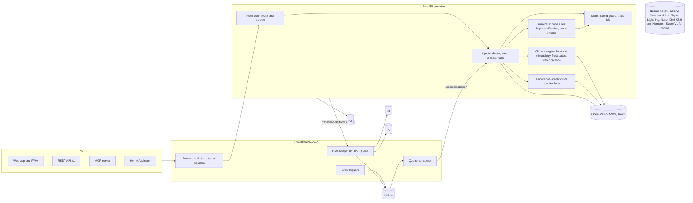
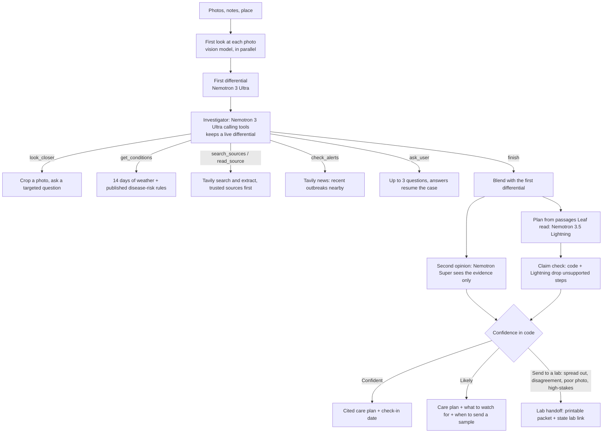
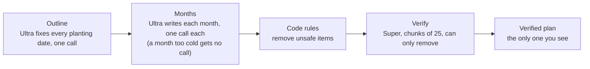
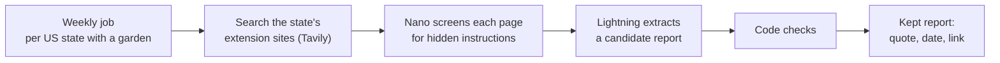

# How Leaf works

The engineering behind each part. To use the site, see the [README](../README.md). For measurements, see [NUMBERS.md](NUMBERS.md).

| Section | Covers |
| --- | --- |
| [Architecture](#architecture) | What runs where, and who holds what |
| [What each model does](#what-each-model-does) | The routing table |
| [Leaf Doctor](#leaf-doctor) | Modes, verdicts, the investigator and its limits |
| [After the diagnosis](#after-the-diagnosis-and-the-plant-journal) | Organic and pet rules, spray windows, check-ins |
| [Care and Today](#care-and-today) | The daily planner's rules |
| [Season Plan](#season-plan) | Writing and checking 52 weeks |
| [Radar](#radar) | Regional reports and how they may influence a diagnosis |
| [Connect](#connect) | API, MCP, Home Assistant |
| [Platform engineering](#platform-engineering) | Hosting, jobs, cost, guardrails |
| [Safety](#safety) | Risks and what stops them |

## Architecture



| Layer | Holds | Rule |
| --- | --- | --- |
| Cloudflare Worker | D1, KV, the queue, the cron schedule | Forwards requests, strips internal headers, refuses `/internal/` paths from outside |
| FastAPI container | All the logic: doctor, care, season, radar | Holds no database credentials; it reaches D1 through the Worker's outbound interception |
| Code | The zone, frost dates, water balance, degree days, disease risk, spray windows, every safety verdict, every limit | Decides |
| Models | Looking, reasoning, writing, verifying | Advise; code checks them |

## What each model does

Every model call goes through `backend/models.py` to Nebius Token Factory. The routing table is `ROUTES` in `backend/config.py`, and `/ops` shows the live mix.

| Model | Role | Used for |
| --- | --- | --- |
| **Nemotron 3 Ultra** (550B, reasoning on) | Reasoner, long writer | Diagnosis and the investigator agent; the season plan (an outline of every planting date, then one call per month); replans |
| **Nemotron 3 Super** (120B) | Verifier, fallback | Verifies every season plan and replan (can only remove items); checks plant identification and species facts; the second opinion in Deep; Ultra's fallback |
| **Nemotron 3.5 Lightning** | Fast volume work | Front door (routing and input safety screen, about 0.4 s), care plan, claim check, chat, notification wording, species fact and Radar report extraction |
| **Nemotron Nano 3** | Background screening | Screens check-in notes and fetched web pages for instructions aimed at an AI reader; triages weather alerts |
| **Kimi K2.6** | Reads photos | About 16 points better first time than NVIDIA's vision model on plant photos ([NUMBERS.md](NUMBERS.md)) |
| **Nemotron 3.5 Super VL** | Photo fallback | Used automatically when a Kimi call fails. Quick and Deep never say Confident when it read the photo |

Why Nano isn't in the user's path: on Token Factory it is slower than Lightning at the same price (1.6 s against 0.4 s median on the 65-message router eval). `CLAUDE.md` says to prefer NVIDIA for the vision step unless the measured accuracy is clearly worse, and to re-measure when a new NVIDIA vision model appears.

## Leaf Doctor

| Mode | What it does | Time | Cost |
| --- | --- | --- | --- |
| **Auto** (default) | Runs Quick; opens a Deep investigation only when Quick isn't confident, seeded with Quick's look so nothing repeats | 15 s to about a minute | about 4 cents |
| **Quick** | One careful look at the photo, a structured diagnosis by Ultra, Tavily search, a care plan by Lightning | about 15 s | under 1 cent |
| **Deep** | An investigator agent working the case with tools, streamed live | about 40 s | about 5 cents |

Every answer ends in one of three verdicts, decided in code (`backend/verdict.py`):

| Verdict | When | What you get |
| --- | --- | --- |
| **Confident** | The leading cause is well ahead, the photo is usable, nothing high-stakes is in play | A cited care plan |
| **Likely** | A clear favourite, but a weaker lead, a close second, or a second opinion that leans elsewhere | The plan, what to watch for, when to send a sample |
| **Send to a lab** | Causes spread out, photo too poor, the second opinion strongly disagrees, or a high-stakes condition is in the top two or at 20% or more anywhere | A printable case summary and your state's plant diagnostic lab |

A high-stakes condition is one where a wrong guess hurts more than the gardener's plant. Each has its source in `backend/diseases.py`:

| Condition | Why it goes to a lab | Source |
| --- | --- | --- |
| Late blight | One spot releases thousands of airborne spores within days; neighbours' tomatoes and potatoes are at risk | [UMN Extension](https://extension.umn.edu/disease-management/late-blight) |
| Boxwood blight | Spreads on moved plants; extension advises a lab diagnosis | [UConn](https://homegarden.cahnr.uconn.edu/factsheets/boxwood-blight/) |
| Sudden oak death | Federal quarantine, 100+ host plants, no treatment | [APHIS](https://www.aphis.usda.gov/plant-pests-diseases/pramorum) |
| Ralstonia race 3 biovar 2 | A US select agent: APHIS asks for an immediate report | [APHIS](https://www.aphis.usda.gov/plant-pests-diseases/ralstonia) |
| Citrus greening | No cure; federal quarantine | [APHIS](https://www.aphis.usda.gov/plant-pests-diseases/citrus-diseases/citrus-greening-and-asian-citrus-psyllid) |
| Tomato brown rugose fruit virus | Regulated by APHIS; breaks tomato resistance genes and spreads on hands | [APHIS](https://www.aphis.usda.gov/plant-pests-diseases/tbrfv/faqs) |
| Spotted lanternfly | Invasive; many states ask residents to report | [APHIS](https://www.aphis.usda.gov/plant-pests-diseases/slf) |
| Box tree moth | Federal quarantine; APHIS asks owners to report damage | [APHIS](https://www.aphis.usda.gov/plant-pests-diseases/box-tree-moth) |



The investigator's tools are all read-only:

| Tool | What it does | Limit |
| --- | --- | --- |
| `look_closer` | Crops a photo region in code and asks the vision model one question | Counted call |
| `get_conditions` | 14 days of Open-Meteo weather through published rules: TOMCAST (tomato), Hutton, Smith and Wallin (potato); each threshold cited in `backend/disease_rules.py` | Counted call |
| `search_sources` | Tavily search, trusted sources first | Per-tool cap |
| `read_source` | Reads a page | Only URLs this case's own searches returned; no URL a model writes is ever fetched |
| `check_alerts` | Tavily news: recent outbreaks nearby | Per-tool cap |
| `ask_user` | Up to three questions that would separate the top two causes | Three |
| `update_differential`, `finish` | Re-rank, then end the investigation | |

| Enforced in code | Value |
| --- | --- |
| Counted tool calls | 8 |
| Clock | Hard 90 seconds, then a forced finish |
| Spend | A dollar budget per case |
| Ultra fails | Falls back to Super for that turn |
| Investigation fails | Falls back to Quick |
| Any probability | Capped at 0.9 |

## After the diagnosis, and the plant journal

| Feature | How it's decided (all in code) | Where |
| --- | --- | --- |
| **Organic and pet-safe plans** | Every step is checked against a table of 33 active ingredients: organic or not (USDA National Organic Program), risk to pets, harm to bees. Steps that break your choice are removed and listed with the reason. Plan-wide warnings cover oil with sulfur (leaf burn), bee-harming products (spray at dusk), and what to do if a pet eats a treated plant. The season plan uses the same table | `backend/actives.py` |
| **Best time to spray** | Scores every daylight hour of the next five days (rules below) and suggests the best 3-hour window | `backend/spray.py` |
| **My plants and reminders** | Every saved report is listed on your device with its verdict, last check-in and the date to check again. Check-in and spray windows export to Google, Apple or Outlook calendars; the `.ics` links can only point at Leaf pages. A private link moves the list to another device | `/plants` |
| **Reports and check-ins** | Saved for 30 days at an unguessable link (`/c/<id>`). A new photo is compared with the last (spreading, stable or recovering), the advice updates, and anything still spreading escalates. A report linked to a garden plant also becomes tasks and a season plan update | `/c/<id>` |

Spray window rules (an hour must pass all of them; the product label always wins):

| Rule | Value |
| --- | --- |
| Time of day | Daylight only, 6:00 to 20:00 local |
| Leaves | Dry: no rain this hour or the two before |
| After spraying | At least 6 dry hours |
| Wind | At most 16 km/h, gusts at most 24 km/h |
| Temperature | From 7 °C up to 32 °C (29 °C with oil or sulfur) |
| Bee-harming products | Only before 8:00 or from 18:00 |

Only small thumbnails of photos are kept, never full uploads.

## Care and Today

Each morning, once per populated time zone, Leaf plans every garden. An afternoon check at 14:00 warns of frost or heat before dark.

| Task | Fires when | Based on |
| --- | --- | --- |
| **Water or skip** | Every plant, every day | Outdoors: the FAO-56 water balance from forecast evapotranspiration and rain. Indoors: a separate heuristic, since the weather never waters houseplants |
| **Frost protection** | Tonight's low is 2.2 °C (36 °F) or below, or an NWS frost or freeze alert starts by tomorrow morning | Forecast and NWS alerts |
| **Heat protection** | 32.2 °C (90 °F) | Forecast and alerts |
| **Wind and flood** | The forecast or an alert says so | Forecast and alerts |
| **Feeding** | Only when a verified fact says how often | Cited species facts |
| **Pest scouting** | Degree days reach a published threshold (table below) | Extension sources |
| **Photo check-in** | Weekly per plant, and the morning after a frost night | Leaf's own rule |

Every task has a reason, a due time and a source, or says it is Leaf's own rule. Pests Leaf times by degree days (accumulated from January 1 unless noted):

| Pest | Event | Degree days (°F) | Base (°F) | Source |
| --- | --- | --- | --- | --- |
| Japanese beetle | Adults start emerging | 1030 | 50 | [Iowa State](https://crops.extension.iastate.edu/cropnews/2023/06/japanese-beetle-adults-now-emerging) |
| Squash vine borer | Moths start emerging | 900 | 50 | [UW Extension](https://hort.extension.wisc.edu/articles/squash-vine-borer/) |
| Cabbage maggot | First flies | 300 | 43 | [UW Vegetable Entomology](https://vegento.russell.wisc.edu/pests/cabbage-maggot/) |
| Onion maggot | First flies | 680 | 40 | [UW Extension](https://hort.extension.wisc.edu/articles/degree-days-common-fruit-vegetable-insect-pests/) |
| European corn borer | First moths | 375 | 50 | [Cornell NYS IPM](https://sweetcorn.nysipm.cornell.edu/2018/05/29/ny-sweet-corn-trap-network-report-5-29-18) |
| Squash bug | Eggs start to appear | 193 | 58 | [UW Vegetable Entomology](https://vegento.russell.wisc.edu/pests/squash-bug) |

Where a source gives no start date, Leaf assumes January 1 and says so.

| Notification rule | How it works |
| --- | --- |
| Wording | Lightning words the morning message; code rejects it if it names a number or a plant the tasks don't |
| Channels | The ones the gardener chose, with quiet hours, dedupe and a daily limit |
| Urgent alerts | Skip quiet hours, because a freeze warning held until 07:00 is too late |

## Season Plan



| Code rule | Removes |
| --- | --- |
| Frost class | Planting out before the earliest date for the plant's class (CSU Extension: hardy, semi-hardy, tender, very tender, counted from the 30-year average last frost) |
| Temperature | A month too cold for the plant |
| Your choices | A product that breaks your organic or pet choices |
| Repeats | A pest check repeated every week |

| Behaviour | How |
| --- | --- |
| Rewrite | The current plan stays on screen until the new one is verified |
| Timeouts | Months are saved as they are written, so a retry writes only what is missing |
| Replans | A frost, a diagnosis or a spreading disease replans only the affected weeks and says what changed and why |

A real production check found a bug the offline tests missed: the outline put a tomato transplant in the week of the earliest allowed date, the rules allowed it with a caution, and Super then removed it, so the plan never planted the tomato out. It is fixed with a rule and a test, and [`LEAF_PLATFORM.md`](LEAF_PLATFORM.md) records it.

## Radar



A report is kept only if every code check passes:

| Check | Rejects |
| --- | --- |
| Date | A page with no recent date of its own (found in code, within 45 days) |
| Quote | A sentence that is not on the page word for word |
| Pest | A quote that doesn't name the pest |
| Sighting | A sentence about what might happen, rather than what was seen |
| State | A page about another state |
| Host | A page outside the state's list of extension hosts (50 states in `backend/radar/regions.py`; Louisiana, Michigan and Oklahoma could not be opened by the checker and are marked) |

Nothing is seeded or written from memory. A report can nudge a diagnosis only through `backend/radar/prior.py`:

| Rule | Value |
| --- | --- |
| Points per distinct source | 2 |
| Maximum | 5 |
| Applies to | A candidate naming the same pest on the same kind of plant |
| Verdict | Decided twice, without and with the prior; the more cautious one stands. A prior can send a serious case to a lab, never make Leaf confident by itself |

## Connect

| Surface | Endpoint | Notes |
| --- | --- | --- |
| REST API v1 | `/api/v1`, OpenAPI at `/api/v1/openapi.json` | Garden, today, season plan, readings, diagnose, identify, weather risk |
| API keys | `/api/gardens/{id}/api-keys` | Belong to a garden, shown once, stored only as a hash. Scopes `read`, `readings`, `tools`. Limits per hour, per day, and for calls that spend model credits, counted in D1 |
| MCP | `/mcp`, Streamable HTTP, no sessions | `diagnose`, `identify`, `care_plan`, `season_plan`, `weather_risk`. Serves both the 2025 `initialize` handshake and the stateless 2026-07-28 protocol |
| Home Assistant | `POST /api/v1/readings` | A reading under 12 hours old replaces the weather estimate for its plant. A test reading is labelled TEST wherever Leaf uses it |

A Telegram bot was built and then cancelled by the maintainer on 2026-10-15; its code was removed.

## Platform engineering

| Concern | How |
| --- | --- |
| Where it runs | Cloudflare Workers and Containers, with D1 (data), KV (caches), Queues (jobs, with a dead-letter queue), R2 (reports) and Cron Triggers. Every model call still goes to Nebius Token Factory |
| Jobs | The Worker's crons fan work out per region and enqueue it. The queue consumer wakes the container only when there is work. Every job is idempotent, retried with backoff, and recorded in D1. The schedule is in [`LEAF_PLATFORM.md`](LEAF_PLATFORM.md) |
| Caching | Forecasts per 0.1° cell per hour; climatology once per cell; species profiles once per species for every user; Radar once per state per week |
| Free allowances | Open-Meteo's is counted in D1 and Leaf stays under 8,000 of 10,000 daily units. Tavily credits are sized each day from the live monthly balance, and the day's start is kept in KV so a restart can't size a second allowance |
| Metering | Every model call is metered by task, model, tokens, cost and latency under a trace id |
| Spend guard | $3 a day hard cap, a brownout at 80% (optional features fall back to rules and templates), rules-only at the cap (care and alerts keep working) |
| Guardrails | Code rules for chemicals, organic, pet, child and bee choices, verdict thresholds and escalation; Super verifies plans; web text is untrusted data checked in code; the front door screens every message (code first, then a model) |
| Cost of services | Open-Meteo (CC BY 4.0), NWS and Tavily within its credits are free. Hosting is Cloudflare Workers Paid (Containers require it), the one paid plan. Model calls use the hackathon's Token Factory credits |

| Service | Used for | Where |
| --- | --- | --- |
| Nebius Token Factory | Every model call: OpenAI-compatible API, native tool calling for the investigator, live per-token prices for the cost meter | `backend/models.py` |
| NVIDIA Nemotron 3 Ultra, Super, 3.5 Lightning, Nano 3 | Every reasoning, writing, verification and screening step | table above |
| Cloudflare Containers | Hosting only | `cloudflare/`, `make deploy-cloudflare` |
| Tavily | Search, extract and news at runtime | `backend/search.py`, `backend/tools.py`, `backend/radar/` |
| Open-Meteo and NWS | Weather, climatology and alerts. Weather data by [Open-Meteo.com](https://open-meteo.com/) (CC BY 4.0) | `backend/climate/` |

## Safety

| Risk | What stops it |
| --- | --- |
| A plan step the source doesn't support | A claim check drops any step whose cited source doesn't support it, and any rate or dose that isn't in the cited passage |
| Chemical misuse | Every chemical step says to follow the product label |
| A wrong, confident answer | Low confidence, a near-tie, a poor photo or a disagreeing second opinion escalates to a lab handoff in code |
| Weather indices mistaken for proof | Disease-risk indices are labelled risk signals from modelled humidity, never proof |
| Harm to pets, children or bees | Plants a garden marks for pets or children never get a step the organic and pet table forbids; toxic plants carry a precaution with its source |
| Prompt injection | User text, web text and model text are sanitised and treated as data inside delimiters; the front door screens every message; Nano screens fetched pages |
| Abuse and cost | Upload size and pixel limits; request bodies capped before they are read; a concurrency cap and a deadline per case; per-IP, per-garden, per-key and daily limits; the spend cap |
| Privacy | Photos are not logged; only thumbnails are kept; locations are rounded; a garden has no account, only a private link whose key is stored as a hash |

## Project layout

```text
backend/    FastAPI app (app.py); Token Factory client (models.py); routing table (config.py)
  data/       D1 or SQLite repository, migrations, KV, the Worker bridge
  climate/    forecast, climatology, frost dates, NWS, risk, water balance, crops
  knowledge/  species profiles with verified facts, plant identification
  care/       the daily planner, pests, sensor override
  season/     season plans: rules, writing, verification, replanning, Doctor wiring
  radar/      regions, collection, regional prior
  connect/    API keys, REST API v1, MCP, management endpoints
  notify/     the notifications service, Web Push
  pipeline.py, deep.py, agent.py, tools.py, critic.py, claims.py   Leaf Doctor
  jobs.py, platform_api.py, metering.py, router.py, cache.py        platform
frontend/   static pages and scripts, no build step
cloudflare/ the Worker (cron fan-out, queue consumer, data bridge) and its config
migrations: backend/data/migrations/0001 to 0007
tests/      offline tests with scripted fake models, tools and search
scripts/    smoke test, evals, calibration, deploy, VAPID setup
evals/      labelled photo cases and their licences; the front-door router eval
docs/       LEAF_PLATFORM.md (architecture, limits, decisions, milestones), PROGRESS.md
```
